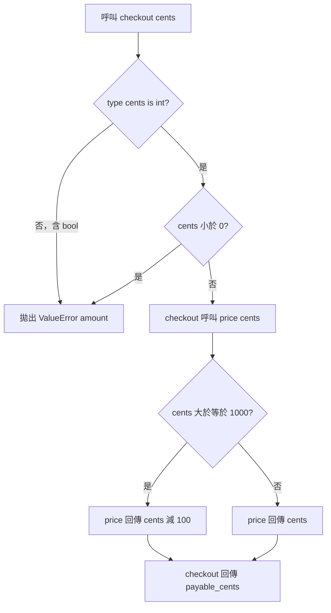

# 程式碼審查：優惠券折扣邊界

## 1. 基本說明

- **建議：Approve（建議通過）；執行完成；需求符合性／品質 PASS。** 約定範圍內未發現阻擋。
- 尚存事項：已確認缺陷 F = 0、待釐清 Q = 0、必要證據缺口 U = 0；見[審查結果](#4-審查結果與問題)。
- 現在先做：可採納此精確 head 的本地審查結論；本報告未提交任何平台 review，也不代表合併已發生。
- 專案／路徑：[S1](/private/tmp/ai-review-real-20261009/S1)，Git repo 位於 `/private/tmp/ai-review-real-20261009/S1/repo`。
- 開始時間：**2026-10-09 11:30:20 UTC（UTC+00:00）**，讀業務來源前取自實際時鐘；[原始輸出](start-clock.json)。
- 目的：依核准需求，1000 cents 起折抵 100 cents，保留公開 checkout 的非負整數驗證及錯誤契約。
- 限制：只涵蓋本地純 API 與 caller；圖未實際渲染。有限案例與來源審查不構成全域正確性保證。

## 2. 範圍說明

| 角色 | ref | 完整 commit |
|---|---|---|
| base | review-base | 80c1003ffe599c71564037d272c7ac58993324c9 |
| head | review-head | 1461797f5ad85f2610fb3ccd88700339110651c2 |

需求指定精確版本比較，採 `git diff review-base review-head` 直接快照比較；已解析 ref、核對 targets.json，merge-base 恰為 base，未偷換三點比較。工作樹乾淨，未切換或修改來源。原始完整狀態／patch／命令見 [inspection.json](inspection.json)。

納入 1 個修改 Python 檔案、1 個差異區塊；關聯查閱兩版未修改的 api.py。Git 樹只有 api.py、pricing.py，沒有既有測試、配置、依賴、生成檔或二進位檔。所有 diff 對帳見[完整檔案清單](#附錄完整檔案清單)，前兩階段紀錄見 [phase-1](phase-1.md)、[phase-2](phase-2.md)。不審外部付款或持久化，這是 contract 明列範圍，並非必要證據缺口。

## 3. 關聯與流程

pricing.price(cents) 的唯一改動是 `> 1000` 改為 `>= 1000`。目的與實際作用一致：合法輸入 1000 cents 的 payable 從 1000 變為 900，其他有效整數行為保留。checkout 先驗證型別與負數，再呼叫 price，回傳 `{"payable_cents": ...}`。沒有交易、事件、共享狀態或外部副作用。

因本次變更涉及輸入 guard 與折扣分支，採一張流程圖說明公開入口如何抵達結果。此圖是**固定來源推導**，不是逐步執行追蹤；實測觀測位於公開 API 回傳／例外。來源為 head [api.py:1–5](snapshots/review-head/api.py:1) 與 [pricing.py:1–2](snapshots/review-head/pricing.py:1)。舊版拓樸相同，折扣條件為嚴格大於。

圖未實際渲染或做視覺可讀性驗證；已人工核對箭頭與 guard。完整文字呼叫鏈亦為：`checkout(cents) → 型別／負數驗證 → price(cents) → payable_cents`，非法輸入直接拋出指定例外。

## 4. 審查結果與問題

**未發現約定範圍內阻擋、待釐清事項或必要缺口；沒有需要修正的問題碼。**

| 類別 | 數量 | 處理 |
|---|---:|---|
| F：已確認缺陷 | 0 | 無待修正事項 |
| Q：待釐清 | 0 | 無待決策事項 |
| U：必要證據缺口 | 0 | 無待補證事項 |

### 需求與實測

依 [contract.json](/private/tmp/ai-review-real-20261009/S1/contract.json) 建立不變條件：非負 int 輸入；bool 非法；非法輸入拋出 `ValueError("amount")`；subtotal ≥ 1000 時折抵 100 整數 cents。測試以這些核准條件定義 expected，沒有採舊版為功能 oracle。

| 案例 | 預期 head | 實際 head | base 對新契約 |
|---|---|---|---|
| checkout(0)、checkout(1)、checkout(999) | 0、1、999 cents | 相符 | 相符 |
| checkout(1000) | 900 cents | 900 cents | 1000 cents，不符合新需求 |
| checkout(1001)、checkout(10000) | 901、9900 cents | 相符 | 相符 |
| checkout(10**100) | 原值減 100，保持 int | 相符 | 相符 |
| 負整數、bool、float、NaN、infinity、str、None、list、dict | ValueError("amount") | 相符 | 相符 |

主驗收共 20 個標準輸入；另 1 個 int subclass 保留既有嚴格型別行為，作為相容性探測，不將 contract 未明言的 subclass 接受度另增為阻擋條件。兩版本各執行 21 案例。head exit 0、21/21 通過；base exit 1，只在 1000 cents 失敗，證明測試能辨識本次必要變更，**不是要求保留舊政策，也不是工具失敗**。原始 stdout／stderr／exit code 見 [tests.json](tests.json)，可重現程式見 [check_contract.py](tmp/check_contract.py)。

### 候選問題反證

- 1000 cents 行為不同：契約明列含等於，因此撤除回歸疑慮。
- price 本身不拒絕 bool／負數：全 Git 樹與 caller 搜尋見 [source-reads.json](source-reads.json)，公開入口 checkout 第 3–4 行已用 `type(cents) is not int or cents < 0` 阻擋。無第二個 caller 或對外入口證據，契約只要求 checkout，不能把內部 helper 當作另外公開 API 報缺陷。
- Python bool 是 int 子類：此處使用精確 `type` 判斷，非 `isinstance`，True／False 已實測被拒。
- 非數字比較可能 TypeError：`or` 短路先拒絕非 int，案例通過，未發現該路徑。

### 已查面向與範圍對帳

| 面向 | 方法與證據 | 結果 |
|---|---|---|
| 功能／金額 | 完整兩版函式、核准邊界、公開入口測試 | PASS；整數運算，無浮點捨入；0–999 不折抵，≥1000 減100仍非負 |
| 安全／信任邊界 | checkout guard、非法類型／負數實測 | PASS；無注入、授權、敏感輸出或依賴變更責任 |
| 可靠性／副作用 | 全 Git 樹與完整 caller | 純計算、固定例外；無提交、timeout、重試或需清理資源 |
| 並行／順序 | 檢查全部來源 | 無共享可變狀態／非同步，競速不適用 |
| 效能／資源 | 一次比較、條件減法及小字典；大型 int 案例 | 無新增迴圈、查詢或無界累積；未作不必要 benchmark |
| 設計／相容性 | API 簽名、字典 key、例外、完整 caller 與兩版比較 | 只改核准邊界；未發現需抽象化／重複驗證理由 |
| 測試品質 | 新契約 expected 與 base/head 紅綠對照 | 能偵測舊版邊界，非法輸入測確切型別與訊息 |
| 全目標對帳 | 1/1 檔案、1/1 區塊、兩版完整 caller | 完成；無未讀／截斷／待查來源 |

## 5. 結論

對 head `1461797f5ad85f2610fb3ccd88700339110651c2` 的核准本地 API 範圍建議 **Approve**。審查執行完成、需求符合性／品質 PASS；這是功能變更，無需另要求嚴格新舊等價。未解除 ID 為零，無需修改來源。

若來源、contract 或測試 runner 改變，先重新固定版本，再核對受影響規則與執行邊界／非法輸入測試，才沿用此結論。未向任何平台送出 review，平台合併政策未查核且非本地範圍。

## 附錄：證據與查核依據

- 實際使用 skill：[SKILL.md](/private/tmp/ai-review-real-20261009/skill/SKILL.md)、[deep-review.md](/private/tmp/ai-review-real-20261009/skill/references/deep-review.md)、[report.md](/private/tmp/ai-review-real-20261009/skill/references/report.md)；本次非移轉，未使用 migration reference 或 snapshot helper。
- 專案規則：[project-setting.md](/private/tmp/ai-review-real-20261009/S1/project-setting.md)，全部產物僅寫 output；需求／版本：[contract.json](/private/tmp/ai-review-real-20261009/S1/contract.json)、[targets.json](/private/tmp/ai-review-real-20261009/S1/targets.json)。
- 工具：clock__curr_time、exec_command、Git、rg、Python 標準庫；模型精確版本未知。環境見 [environment.json](environment.json)。未使用外部服務、安裝套件、既往報告或範圍外來源。
- 完整原始命令、stdout、stderr、退出碼：[inspection.json](inspection.json)、[source-reads.json](source-reads.json)、[tests.json](tests.json)。快照透過固定 Git commit 讀取，無來源修改。
- 重現 head：`PYTHONDONTWRITEBYTECODE=1 python3 /private/tmp/ai-review-real-20261009/S1/output/tmp/check_contract.py /private/tmp/ai-review-real-20261009/S1/output/snapshots/review-head review-head`。預期 exit 0。把兩個 review-head 改成 review-base，可重現舊版只在 1000 失敗之 exit 1。
- 檔案 SHA-256 集中於 [hash-index.md](hash-index.md)；核對輸出見 [hash-check.json](hash-check.json)。報告回讀紀錄見 [report-readback.md](report-readback.md)。

## 附錄：完整檔案清單

| 狀態／舊→新路徑 | 符號／責任 | 差異作用／影響 | 分析狀態 |
|---|---|---|---|
| M pricing.py → pricing.py | price(cents)，第 1–2 行 | 第 2 行 > 改 >=；1000 折抵 100 | 全檔／唯一区塊已審；[base](snapshots/review-base/pricing.py:1)、[head](snapshots/review-head/pricing.py:1)；無 F/U |

關聯但未修改來源：

| 路徑 | 責任與關聯 | 分析狀態 |
|---|---|---|
| api.py（兩版相同） | checkout(cents) 驗證、呼叫 price、回傳 payable_cents | 第 1–5 行完整已審及入口實測；[base](snapshots/review-base/api.py:1)、[head](snapshots/review-head/api.py:1)；無 F/U |

Git 完整樹已對帳。無新增／刪除／改名、生成、二進位、測試或配置 diff；無工具失敗或未讀項。外部持久化與付款依契約排除，未假稱已驗證。
