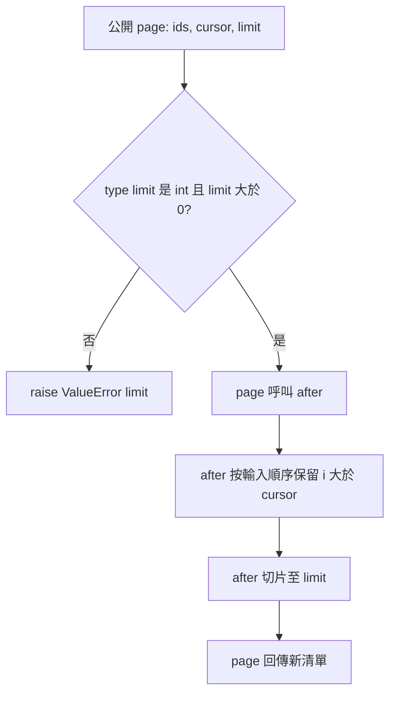

# 程式碼審查：排除游標本身的分頁修正

## 1. 基本說明

- **建議：Approve（建議通過）**。審查執行完成；約定需求及品質查核 PASS；未發現未解除阻擋。
- 尚存事項：已確認缺陷 F = 0、非阻擋建議 Q = 0、必要證據缺口 U = 0。[查核結果](#4-審查結果與問題)。
- 現在先做：可依本次範圍採納此修正；本報告是本地版本審查建議，未提交平台 review 或變更合併設定。
- 專案：[S2](/private/tmp/ai-review-real-20261009/S2)，Git repo：`/private/tmp/ai-review-real-20261009/S2/repo`。
- 本輪開始：**2026-10-09 11:30:28 UTC（UTC+00:00）**，於讀取技能及業務來源前由時鐘工具取得，[原始時間紀錄](start-time.txt)。
- 目的：修正 exclusive cursor 分頁會重複回傳 cursor 的錯誤，保留順序、筆數上限與公開入口驗證。
- 限制：僅本地記憶體 API；圖未實際渲染，不宣稱視覺驗證。有限測試不保證全部可能輸入。

## 2. 範圍說明

| 角色 | ref | 完整 commit |
|---|---|---|
| base | review-base | `3159b0975832c88522dfec4d13adf851ec8d6ada` |
| head | review-head | `3d77b50fc326b13369731b13939e841c681742ea` |

採固定 commit 三點 branch diff。merge-base 實際等於 base；ref 與 targets.json 相符，初始 working tree clean。[原始 Git 證據](logs/git-2.json)、[完整 patch](logs/git-4.json)。

變更只有一個 Python 檔、一個差異區塊：`paging.py` 的 `>=` 改成 `>`。已先保存[階段一盤點](stage1.md)，再完成[階段二全目標分析](stage2.md)。完整清單位於[報告最後一節](#附錄完整檔案清單)。

兩版所有 tracked 檔案均讀取：分頁核心及唯一 caller `api.py`；無 repo 測試、配置、文件、生成或二進位檔。新增檢查置於 output/tmp，不改來源。排除其他 S*、父層 oracle、歷史報告、母專案、外部服務及直接呼叫內部 helper 的契約外輸入。

契約事實：ids 為排序且唯一的整數、cursor 為整數、limit 必須為正整數且 bool 不合法；page 是唯一公開入口並負責 limit 驗證。ids/cursor 的無效型別不在此次有效輸入域，也沒有要求新增其驗證。

## 3. 關聯與流程

因本次修正涉及邊界比較與入口 guard，使用一張流程圖回答「非法 limit 是否能到核心，以及哪個運算排除 cursor」。拓樸兩版相同，只是篩選比較改變。圖屬完整原碼推導；測試觀測公開輸入/輸出，未進行逐步執行追蹤。



固定 head 來源：[api.py 第 1–5 行](snapshots/3d77b50fc326b13369731b13939e841c681742ea/api.py)、[paging.py 第 1–2 行](snapshots/3d77b50fc326b13369731b13939e841c681742ea/paging.py)。圖已核對 guard、拒絕出口、呼叫方向與資料順序；未實際渲染。

完整公開入口（base/head 相同）：

```python
from paging import after
def page(ids, cursor, limit):
    if type(limit) is not int or limit < 1:
        raise ValueError("limit")
    return after(ids, cursor, limit)
```

head 核心原碼（上述固定來源第 1–2 行）：

```python
def after(ids, cursor, limit):
    return [i for i in ids if i > cursor][:limit]
```

base 的 `i >= cursor` 在 `[1,3,5]`、cursor=3、limit=2 回傳 `[3,5]`；head 回傳正確 `[5]`。這是需求授權修正的 bug，不是應保留的差異。清單生成保留排序順序，正 limit 切片保證上限；輸入未修改，不存取外部資源。影響邊界是整數游標的相等情況，沒有 API 簽名或其他 caller 變動。

## 4. 審查結果與問題

**約定範圍未發現阻擋或必要證據缺口；無尚存 F/Q/U，因此沒有要求修改的問題碼或修法。**

反證查核：單獨向 after 傳入負數或 bool limit 可能得到不適當切片，但 contract 明定 page 為唯一公開 caller；完整 page guard 在兩版均排除這些輸入，實測也確認 ValueError。故不把契約外 helper 調用列為缺陷。對排序／唯一性的要求屬有效輸入前提，沒有擅自擴成需拒絕所有非法 ids 的新需求。

| 查核面向 | 方法與直接證據 | 結果 |
|---|---|---|
| 正確性／業務規則 | page 的 exact-boundary、empty、before-first、after-last、exact-last、between、cap；另對 -2..2 全部排序唯一子集合、cursor -3..3、limit 1..6 做 1,344 組 oracle 比對 | head 全通過；保持順序、上限及排除 cursor |
| 安全／輸入邊界 | page guard 原碼；limit=0,-1,True,False,1.5,'2',None | 全部拒絕；bool 未因 int 子類關係漏過。無敏感操作、授權或注入面 |
| 可靠性／副作用 | 完整兩方法；指定正常案例檢查 ids 未變更 | 無外部呼叫、資源、交易或狀態寫入；例外在 helper 前發生 |
| 並行／順序 | 無共享狀態寫入；清單生成沿輸入順序 | 並行同步機制不適用；順序受 oracle 驗證 |
| 效能／資源 | 前後皆完整掃描及生成中間清單 | 時間/中間空間仍 O(n)；沒有新增退化，未要求大型效能量測 |
| 設計／相容性 | 完整兩版、rg caller、檔案樹 | 簽名與公開驗證不變，僅修正已授權的相等邊界 |
| 測試有效性 | 同一 runner 分別執行真實 base/head 快照 | base exit 1，head exit 0；能抓原 bug，非只驗證新版回傳值 |

測試共 7 個具名正常/邊界案例、7 個拒絕案例及 1,344 組 oracle。base 共 483 個失敗（3 個具名加 480 個 oracle），符合已知缺陷；head 0 失敗。原始 stdout/stderr/exit code 位於 [base 紀錄](logs/test-base.json)、[head 紀錄](logs/test-head.json)。既有 repo 無測試檔；本輪補充 runner 提供可重現證據，沒有要求把測試加入來源作為額外放行門檻。

## 5. 結論

對固定 head `3d77b50fc326b13369731b13939e841c681742ea` 及 contract 的本地記憶體公開 API 範圍，建議 **Approve**。必要案例與全目標深度查核完成，無未解除 ID。舊 bug 的紅綠對照證明比較符號修正有效；不要求保留舊錯誤行為。

此結論不涵蓋契約外資料、外部整合或平台合併政策。版本、契約或公開 caller 改變時，需重新確認 guard、差異及重跑相同 runner；目前沒有必要待補項。

## 附錄：證據與查核依據

- 使用技能：`/private/tmp/ai-review-real-20261009/skill/SKILL.md`；實讀 `references/deep-review.md`、`references/report.md`。固定簡單 Git snapshot 以 git show 自行保存，未使用 review.py，也不需要 migration.md/evidence.md 的移轉或結構化輔助流程。
- 規則：S2/project-setting.md、contract.json、targets.json；模型精確版本未知，未猜測。
- [檔案 SHA-256 核對索引](hash-index.md) 收錄實際使用的技能／reference／規則、工具、快照、測試及原始證據。checker 的命令與 stdout/stderr/exit code 為 [hash-check.json](logs/hash-check.json)。
- [Python 版本](logs/runtime.json)。所有測試命令均設定 `PYTHONDONTWRITEBYTECODE=1`。未安裝工具、未寫入來源或 skill。
- 可重現 head：

```sh
PYTHONDONTWRITEBYTECODE=1 python3 /private/tmp/ai-review-real-20261009/S2/output/tmp/test_pagination.py /private/tmp/ai-review-real-20261009/S2/output/snapshots/3d77b50fc326b13369731b13939e841c681742ea
```

base 將最後路徑改成 `3159b0975832c88522dfec4d13adf851ec8d6ada`，預期 exit 1。Git 與測試原始命令、stdout、stderr、exit code 均存 output/logs JSON，不把預期紅燈當新版失敗。

## 附錄：完整檔案清單

| 狀態／舊 → 新路徑 | 符號或責任 | 差異作用／影響 | 分析狀態／證據 |
|---|---|---|---|
| M `paging.py` → `paging.py` | after(ids,cursor,limit)，第 1–2 行 | 唯一 @@ -1,2 +1,2 @@；>= 改 >，排除游標本身 | 完整方法、差異區塊及相關維度已查；[patch](logs/git-4.json)、[head 測試](logs/test-head.json)；無 F/U |

關聯但未修改來源：

| 路徑 | 責任與查閱範圍 | 結果 |
|---|---|---|
| `api.py`（兩版） | 完整第 1–5 行；page guard 及唯一 after caller | 驗證正 int limit 且拒絕 bool；公開路徑實測通過 |
| `contract.json` | 全部需求 | 原 bug 可改，五類必測完成，有效輸入及公開邊界已採用 |
| `targets.json` | base/head repo/ref/commit | ref 解析及 merge-base 實測吻合 |
| `project-setting.md` | 輸出與唯讀規則 | 所有新增產物位於 output |

無其他 tracked 檔案、生成／二進位／刪除／未讀目標，無工具失敗或截斷造成的必要缺口。其他情境、外部服務及無效 ids/cursor 契約外案例明確排除。
