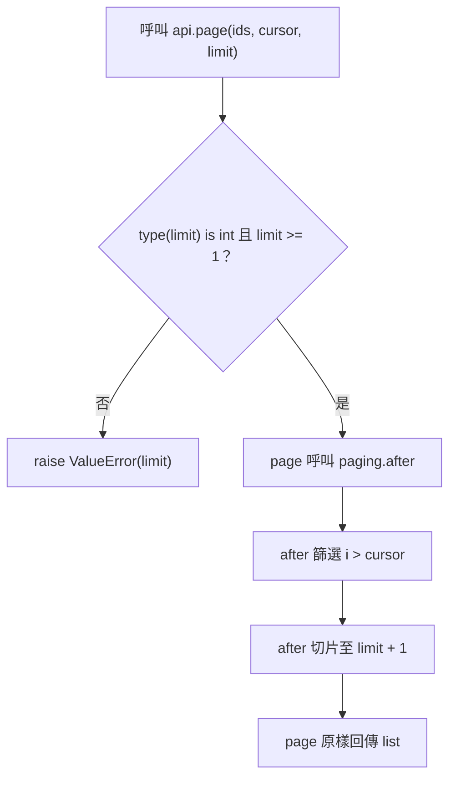

# S3 程式碼審查：exclusive cursor pagination 修正

## 1. 基本說明

- **執行完成；需求符合性 FAIL；建議 Request changes（要求修改）**。游標排除修正有效，但新增可公開觸發的筆數上限回歸。
- 尚存事項：1 個已確認阻擋 F-001、0 個非阻擋建議、0 個必要證據缺口。見[審查結果](#4-審查結果與問題)。
- 現在先做：將 `paging.after` 的切片上限恢復為 `limit`，保留 `i > cursor`，再重跑本輪 8 個測試。
- 專案：[S3](/private/tmp/ai-review-real-20261009/S3)，被審 repository：[repo](/private/tmp/ai-review-real-20261009/S3/repo)。
- 本輪開始：**2026-10-09 11:30:38 UTC（UTC+00:00；臺北 19:30:38 UTC+08:00）**，業務來源讀取前呼叫時鐘取得；[原始時鐘值](/private/tmp/ai-review-real-20261009/S3/output/start-clock.json)。
- 目的：依 [contract.json](/private/tmp/ai-review-real-20261009/S3/contract.json) 修復排他游標分頁，不保留舊版回傳游標本身的 bug，仍須保留排序與 limit 上限。
- 限制：僅本地記憶體 API 範圍；沒有實際 PR／平台動作。Mermaid 未實際渲染，修法僅建議、未套用或實跑。

## 2. 範圍說明

| 版本 | 原 ref（Git tag） | 固定 commit |
|---|---|---|
| base | review-base | 3159b0975832c88522dfec4d13adf851ec8d6ada |
| head | review-head | f3ea1892ae704f155c2f837bde3e2312032af50f |

採一般分支審查語意：`git diff <base>...<head>`；實測 merge-base 等於上述 base，因此此範圍亦與兩版內容差異相同。未切換／清理工作樹。Git status 空白；ref 與 targets.json 相符。從固定 commit 匯出到 output/snapshots，逐位元核對 supplied base/head 與 head 工作樹兩檔一致。

差異清單：1 個修改 Python 檔、1 個 hunk、1 行替換；無增刪／改名、配置、文件、生成或二進位差異。相關未修改檔 `api.py` 及 supplied `probe.py` 全文已讀；完整檔案清單見本文最末節。呼叫搜尋與 Git tree 核對沒有其他 repo caller／測試；`page` 為唯一公開入口亦由契約明定。

必要不變條件：輸入為已排序、唯一 integer IDs 與 integer cursor；有效 limit 是正 integer，bool 無效；回傳值皆大於 cursor、保留輸入順序、最多 limit 筆；不修改輸入。ID／cursor 型別與唯一排序是本輪有效輸入前提，不額外擴張為新驗證需求。未檢查網路、資料庫或平台合併規則，因本輪沒有這些責任與授權。

## 3. 關聯與流程

全目標分析：`paging.after(ids, cursor, limit)` 將篩選由 `>=` 改為 `>`，符合排他游標目的；同一 hunk 把 `[:limit]` 改為 `[:limit + 1]`，使合格資料多於 limit 時回傳多一筆。`api.page` 的型別／正值 guard 維持不變，直接呼叫 helper 並回傳，沒有二次截斷。資料只在本地 list comprehension 與 slicing 形成新 list，沒有外部寫入。

因判斷依賴 guard 與公開入口是否限制 helper 輸出，選一張流程圖說明有效／拒絕分支。圖為固定 head 的**來源推導**；測試是入口與末端結果觀測，沒有逐步執行追蹤。未實際渲染，僅核對 Mermaid 原碼、箭頭與來源。



固定來源：[head api.py:1–5](/private/tmp/ai-review-real-20261009/S3/output/snapshots/head/api.py:1)、[head paging.py:1–2](/private/tmp/ai-review-real-20261009/S3/output/snapshots/head/paging.py:1)。base 拓樸相同，僅篩選比較與切片上限不同。圖中的 `ValueError(limit)` 表示訊息字串 `"limit"`，不是以輸入數值作訊息。

## 4. 審查結果與問題

F 代表已確認缺陷。沒有其他尚存待釐清事項或必要證據缺口。

| ID／狀態 | 問題及影響 | 阻擋理由 | 推薦方案 | 解除條件 |
|---|---|---|---|---|
| [F-001](#f-001有效分頁可能回傳-limit--1-筆)／open | 有效分頁多回傳一筆，破壞 cap | 是；違反明定 Preserve order and cap | 保留 `>`，切片恢復 `[:limit]` | 原有排他游標案例與新增 cap 案例全部通過，重審固定新 commit |

### F-001：有效分頁可能回傳 limit + 1 筆

位置：[head paging.py 第 2 行](/private/tmp/ai-review-real-20261009/S3/output/snapshots/head/paging.py:2)，函式 `after(ids, cursor, limit)`（無型別註記），head commit 如第二章。歸屬：**本次新增回歸**。影響是公開 API 違反回傳筆數上限；不是風格問題，也不是保留舊 bug 的要求。

**原始問題碼，head 全方法第 1–2 行：**

```python
def after(ids, cursor, limit):
    return [i for i in ids if i > cursor][:limit + 1]
```

**建議修改：僅替換第 2 行切片（未套用、未實跑修法）。**

```python
def after(ids, cursor, limit):
    return [i for i in ids if i > cursor][:limit]
```

保留排他游標條件，只恢復約定的上限；不增加新 helper 或更動 guard。

**公開入口與反證查核：**[head api.py 第 1–5 行](/private/tmp/ai-review-real-20261009/S3/output/snapshots/head/api.py:1) 原樣如下：

```python
from paging import after
def page(ids, cursor, limit):
    if type(limit) is not int or limit < 1:
        raise ValueError("limit")
    return after(ids, cursor, limit)
```

已確認 guard 只拒絕無效 limit；有效 limit=1、2 可進入，回傳前沒有裁切。不能用 helper 在 bool／負值時的行為另立 finding，因契約的公開 caller 已排除此輸入路徑。也沒有 look-ahead／has-more 的合約可授權多傳一筆。

| 初始資料／操作 | 規格預期 | base 實際 | head 實際 |
|---|---|---|---|
| `page([1,2,3], 0, 1)` | `[1]` | `[1]` | `[1,2]` |
| `page([1,3,5,7], 2, 2)` | `[3,5]` | `[3,5]` | `[3,5,7]` |
| `page([1,2,3], 2, 2)` | `[3]` | `[2,3]`（既有 bug） | `[3]`（修復有效） |

前兩案證明 cap 是新增退化，第三案證明新需求的修正已生效；不能以「兩版都兩個 failures」視為等價。資料有效、sorted unique integer IDs，cursor 與 limit 合約均成立。

原始證據：[head stdout](/private/tmp/ai-review-real-20261009/S3/output/logs/test-head.stdout)、[head stderr](/private/tmp/ai-review-real-20261009/S3/output/logs/test-head.stderr)、[base stdout](/private/tmp/ai-review-real-20261009/S3/output/logs/test-base.stdout)、[base stderr](/private/tmp/ai-review-real-20261009/S3/output/logs/test-base.stderr)。兩版測試 exit 1；head 8 個方法中 2 fail（上述 cap）、其餘通過；base 2 fail 是 exact cursor 與 last cursor，不是 cap。

解除：固定修正版，再以公開入口重跑 8 個方法（含 7 個 invalid-limit subcases）；要求所有預期結果與例外通過，保持輸入不變、排序、排除 cursor、cap。現有建議碼只做來源推導，尚不能稱 verified。

### 已查面向與測試品質

| 面向 | 查法與證據 | 結果／邊界 |
|---|---|---|
| 正確性 | 完整兩版方法、公開 caller；exact-boundary、empty、before-first、after-last、last-cursor、between-IDs、large-limit | 排他游標修復；cap F-001；空值集合與順序案例通過 |
| 安全／驗證 | 讀 `type(limit) is not int or limit < 1`，實跑 0、-1、True、False、1.0、字串、None | 兩版皆 ValueError；無敏感 sink／外部信任邊界，不捏造認證議題 |
| 可靠性／副作用 | 新 list comprehension／slice；每個有效測試檢查輸入未變 | 無狀態提交、清理或重試責任；無資料寫入 |
| 並行／順序 | 同步純本地函式；列表順序保持 | 無共享可變狀態或 async，競態查核不適用 |
| 效能／資源 | 兩版均先掃描完整 ids，再切片，時間／暫存空間均線性 | 未新增無界外部資源；未做效能 benchmark，沒有具體新增效能阻擋依據 |
| 設計／相容性 | 全 repo Python caller 搜尋、簽名與 guard 保持、回傳筆數契約 | 無簽名改動；唯一相容性回歸為 F-001 |
| 測試有效性 | 自製 assertions 取自契約，分開跑兩版；supplied probe 亦實跑 | 可同時抓舊游標 bug 與新 cap bug；probe 只有 print，exit 0 不代表驗收通過 |

probe head 的原始輸出為 `[[3], [], [1, 2]]`，第三項已暴露 cap 問題，但沒有 assertion，因此其 exit 0 不能覆蓋測試失敗。新增測試共 8 方法，invalid-limit 方法含 7 子案例；未把此數字說成全輸入域證明。

## 5. 結論

在固定 head 與本地記憶體公開 API 範圍內，**審查完成、需求 FAIL、Request changes**。尚未解除 F-001；無必要缺口。建議先改切片上限，保留排他判斷，再執行本輪測試並用修正版固定 commit 重審。未修改程式、未提交平台 review，報告也未禁止任何真實 PR 合併。

## 附錄：證據與查核依據

- 實際使用：[SKILL.md](/private/tmp/ai-review-real-20261009/skill/SKILL.md)、[deep-review.md](/private/tmp/ai-review-real-20261009/skill/references/deep-review.md)、[report.md](/private/tmp/ai-review-real-20261009/skill/references/report.md)、[project-setting.md](/private/tmp/ai-review-real-20261009/S3/project-setting.md)、contract.json、targets.json。未使用 migration／snapshot helper，因範圍小，直接 Git 固定快照足夠。
- [命令索引](/private/tmp/ai-review-real-20261009/S3/output/commands.json) 含實際 argv、cwd、必要環境變數、UTC 執行時間、exit code 與各 stdout／stderr 檔；[原始 patch](/private/tmp/ai-review-real-20261009/S3/output/logs/patch.stdout)。測試工具 Python 3.14.8、Git 2.56.0；模型版本未由可信工具識別，記未知。
- [取證 runner](/private/tmp/ai-review-real-20261009/S3/output/tmp/collect.py) 匯出固定版本並核對輸入快照；[可重現測試](/private/tmp/ai-review-real-20261009/S3/output/tmp/test_review.py) 不更動來源，以環境變數禁止 bytecode cache。
- [SHA-256 核對索引](/private/tmp/ai-review-real-20261009/S3/output/hashes.md) 記錄規則、skill、references、來源、runner、測試及證據。已執行技能 hash checker，51 項 exit 0；[原始核對 stdout](/private/tmp/ai-review-real-20261009/S3/output/hash-check.stdout)、[命令與退出碼](/private/tmp/ai-review-real-20261009/S3/output/hash-check-command.json)。索引與 hash checker 的紀錄獨立保存，避免循環雜湊。
- 分階段執行：先取得完整 diff 與 caller，盤點唯一 hunk；再追 guard 與回傳；以規格作 assertion 執行兩版反證；最後對帳形成報告。所有 diff 區塊已查，無待讀項。已全文回讀實際報告，核對五章順序、首頁待辦、F-001 的來源／案例／建議與最後完整清單；修正少量繁簡混字，保留未渲染與修法未跑限制。

重跑單一版本（預期目前 head exit 1，是測試正確揭露回歸）：

```sh
PYTHONDONTWRITEBYTECODE=1 python3 /private/tmp/ai-review-real-20261009/S3/output/tmp/test_review.py /private/tmp/ai-review-real-20261009/S3/output/snapshots/head
```

## 附錄：完整檔案清單

| 狀態／舊→新路徑 | 方法／責任 | 差異作用／影響 | 分析狀態／證據 |
|---|---|---|---|
| M `paging.py` → `paging.py` | `after(ids,cursor,limit)` | 唯一 hunk 第 2 行：`>=`→`>`，`limit`→`limit + 1` | 全方法／所有 hunk 已查；排他修正有效，cap 回歸 F-001；固定來源 output/snapshots/base、head |

關聯但未修改的來源與材料：

| 路徑／分類 | 責任 | 查核狀態 |
|---|---|---|
| `api.py`（base/head） | 唯一公開 `page`、limit guard、回傳責任 | 全文已讀、兩版一致、測試實際由此入口；反證否定無效 limit finding |
| S3 `probe.py` | 三個分頁結果 print，沒有斷言 | 全文已讀及兩版實跑；不可當 pass 證明 |
| S3 `contract.json` | 需求與驗收邊界 | 全文已讀、作測試／判斷依據 |
| S3 `targets.json` | ref、commit、repo 路徑 | 全文已讀、以 Git 解析核對 |
| S3 `project-setting.md` | 來源唯讀、產物位置 | 全文已讀；產物僅 output |
| S3 `base/`、`head/` 中 api.py、paging.py | supplied raw snapshots | 全文已讀、與固定 commit 匯出逐位元一致 |
| repo `.git/` | Git 版本證據 | 只經 Git 查狀態、ref、tree、merge-base、diff、show；非業務差異目標 |

無生成檔／二進位差異、無未讀差異或工具失敗待補項。其他 S 情境、父層 oracle、歷史報告與母專案皆排除且未查看。
