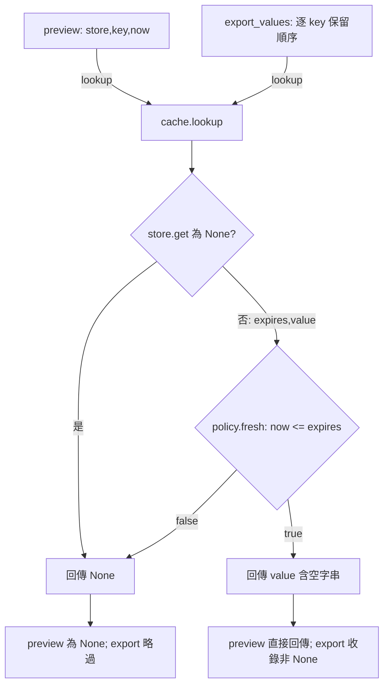

# 程式碼審查：快取有效性判斷重構

## 1. 基本說明

- 建議：**Request changes（要求修改）**；審查執行完成，需求符合性 FAIL、行為一致性 FAIL。
- 尚存事項：1 個已確認阻擋缺陷 [F-001](#f-001到期當下仍回傳及匯出過期值)，0 個非阻擋建議、0 個必要證據缺口。
- 第一步：把 `policy.fresh` 的 `<=` 恢復成 `<`，補上兩個 caller 的相等邊界測試。
- 專案：[S4](/private/tmp/ai-review-real-20261009/S4)；repository：[repo](/private/tmp/ai-review-real-20261009/S4/repo)。
- 實際開始時間：**2026-10-09 11:30:45 UTC（+00:00）**，取自時鐘工具，見 [原始時間輸出](/private/tmp/ai-review-real-20261009/S4/output/start-time.json)。
- 目的：僅重構，完整保留 preview 與 export_values 的有效性、空字串與順序語意。
- 限制：本地單執行緒契約範圍；Mermaid 未實際渲染。這是固定版本的審查建議，未提交平台 review。

## 2. 範圍說明

| 版本 | 原 ref | 固定 commit |
|---|---|---|
| base | review-base | 06ecf76f8d530a58543ea46ab16a2cd8671e5fe6 |
| head | review-head | e12142caae223d49fc019618c96a5bf6422a848b |

同 repository 的 merge-base 等於 base，採 `git diff review-base...review-head`，ref 已解析並吻合 targets.json。工作樹起始為乾淨。[Git 原始命令、完整 patch、stdout/stderr/exit code](/private/tmp/ai-review-real-20261009/S4/output/git-records.json)。

2 個 Python 差異檔案：修改 1、新增 1，共 2 個 hunk；完整閱讀各 hunk、完整函式及未修改的兩個 caller。tracked tree 沒有測試、設定、文件、生成或二進位檔。已保存兩版本完整來源快照。目標及責任對帳見[完整檔案清單](#附錄完整檔案清單)。未讀取其他情境、父層 oracle 或歷史報告。

規格來源：[contract.json](/private/tmp/ai-review-real-20261009/S4/contract.json)。輸入是整數 expiration／now、字串 value（含空字串）；fresh 當且僅當 `now < expiration`；missing/expired 回傳 None；export 保留輸入順序與有效空字串。無外部時鐘或並行需求。

## 3. 關聯與流程

目的為抽出 freshness 規則；cache.lookup 原本內嵌 `<`，新版改呼叫 fresh，但 fresh 實際使用 `<=`。missing guard 與 tuple unpack 未變。preview 原樣轉交結果；export 用 `is not None` 收錄結果，會保留空字串及重複鍵，這部分符合要求。資料只有讀取，無寫入 store 或外部副作用。

因錯誤發生在共用條件，使用一張函式／分支關係圖回答兩入口如何同時受影響；箭頭是呼叫或結果條件，不代表額外執行追蹤。



圖由 head [cache.py](/private/tmp/ai-review-real-20261009/S4/output/snapshots/head/cache.py:1)、[policy.py](/private/tmp/ai-review-real-20261009/S4/output/snapshots/head/policy.py:1)、[views.py](/private/tmp/ai-review-real-20261009/S4/output/snapshots/head/views.py:1) 來源推導；base 拓樸少了 policy 委派，直接用嚴格 `<`。F-001 位於 false/true 的相等界線。實測覆蓋兩入口末端輸出，未做逐步 tracer；圖未實際渲染，已人工核對箭頭與 guard。

## 4. 審查結果與問題

F 表示已確認缺陷；本輪沒有需另列的調查項或必要缺口。

| ID／狀態 | 問題與影響 | 阻擋理由 | 推薦方案 | 解除條件 |
|---|---|---|---|---|
| [F-001](#f-001到期當下仍回傳及匯出過期值)／open | 到期當下兩入口仍輸出過期值 | 違反純重構及明定 fresh 契約 | 共用 fresh 恢復 `<` | 固定修正版，兩 caller 邊界及相鄰案例全部符合契約 |

### F-001：到期當下仍回傳及匯出過期值

位置：head e12142c，根因 [policy.py:2](/private/tmp/ai-review-real-20261009/S4/output/snapshots/head/policy.py:2)，`fresh(now, expires)`。歸屬為本次新增的行為回歸，影響所有到期相等輸入的預覽／匯出；因明確違反契約而阻擋，並非風格偏好。

**原始問題碼**，policy.py 第 1–2 行（完整函式）：

```python
def fresh(now, expires):
    return now <= expires
```

head cache.py 第 1–7 行（完整呼叫及 missing guard）：

```python
from policy import fresh
def lookup(store, key, now):
    item = store.get(key)
    if item is None:
        return None
    expires, value = item
    return value if fresh(now, expires) else None
```

head views.py 第 1–5 行（兩版本均相同，完整 caller）：

```python
from cache import lookup
def preview(store, key, now):
    return lookup(store, key, now)
def export_values(store, keys, now):
    return [v for key in keys if (v := lookup(store, key, now)) is not None]
```

**建議修改**：替換 policy.py 第 2 行，來源推導方案，未套用或測試修正版：

```python
def fresh(now, expires):
    return now < expires  # 到期當下即失效，保留原契約。
```

具體實測案例：`now=0`、`store={'a': (0, ''), 'b': (1, 'B'), 'c': (-1, 'C')}`。`preview(store,'a',0)` 預期 None，head 得到 `''`；`export_values(store,['b','a','missing','c','a','b'],0)` 預期 `['B','B']`，head 得到 `['B','','','B']`。非空字串 `'value'` 在相同邊界也有相同回歸，不能以空字串視為無資料來規避。

反證查核：missing guard 只排除不存在的 item，無法排除已存在且到期的 item；兩個 caller 沒有 `now != expiration` 前置條件，契約的整數同時鐘也未排除相等。export 的 `is not None` 是保留有效空字串所必要，不應改為 truthiness 過濾。根因集中於 policy；兩入口不拆成兩個 finding。

實測同一組 56 檢查：base 全部符合（exit 0）；head 有 12 個相等邊界不符（exit 1），其餘 44 個通過。所有 -1/0/1 now×expiration 組合與空／非空字串、missing、空 keys、重複／順序均有覆核。有限案例不證明任意資料，但此反例與完整來源足以證明違約。見 [head 原始輸出](/private/tmp/ai-review-real-20261009/S4/output/head-test.stdout)、[base 原始輸出](/private/tmp/ai-review-real-20261009/S4/output/base-test.stdout) 及 [執行紀錄](/private/tmp/ai-review-real-20261009/S4/output/test-records.json)。

解除條件：在固定修正版重跑測試，確認相等時 preview 回傳 None、export 排除該值；未到期空字串、重複鍵與順序仍保留，missing／已過期與空集合維持原行為。必要 regression tests 應納入專案；本次審查不改來源。

| 已查面向 | 方法／證據與結論 |
|---|---|
| 正確性與相容性 | 完整路徑及 56 個契約檢查；F-001，簽名未變，None sentinel 與空字串區分保留 |
| 安全／信任邊界 | 本地 dict/整數/字串契約；無外部輸入 sink、認證或敏感輸出改動，不延伸臆測安全缺陷 |
| 可靠性／副作用 | 讀取與比較均無資料寫入；原 missing guard 保留，無交易／外部呼叫／資源清理責任 |
| 並行／時鐘 | contract 明定單執行緒且呼叫者供給同時鐘整數，並行競速與外部時鐘不適用 |
| 效能 | lookup 仍每鍵一次 store.get，export 順序線性；只增加一次函式委派，無具體效能風險，未做 benchmark |
| 設計／測試 | 抽出共用 policy 的結構可行；兩 caller 均讀取及實測；repo 無既有測試，審查測試捕捉 base/head 差異 |

## 5. 結論

對固定 head 的約定範圍建議 **Request changes**，未解除項只有 F-001。先修正共用比較條件並補兩入口 regression tests，再固定新 commit 重驗上述案例；通過後才可解除。全目標審查完成不代表程式通過，亦不代表真實 PR 已被平台阻擋。

## 附錄：證據與查核依據

- [分階段盤點與影響分析](/private/tmp/ai-review-real-20261009/S4/output/analysis-stages.md)、[Git 紀錄](/private/tmp/ai-review-real-20261009/S4/output/git-records.json)。
- [可重現測試程式](/private/tmp/ai-review-real-20261009/S4/output/tmp/check_behavior.py)：`PYTHONDONTWRITEBYTECODE=1 python3 /private/tmp/ai-review-real-20261009/S4/output/tmp/check_behavior.py base`，head 將最後參數換成 `head`。預期原 base exit 0、原 head exit 1。
- [Python 環境](/private/tmp/ai-review-real-20261009/S4/output/environment.json)、[命令／stdout／stderr／退出碼](/private/tmp/ai-review-real-20261009/S4/output/test-records.json)。stderr 皆為空。
- 實際採用指定 ai-code-review SKILL.md、references/deep-review.md、references/report.md，以及 S4/project-setting.md、contract.json、targets.json。未採用 snapshot helper，使用 Git 完整 patch／show 與 Python 本地測試；hash checker 僅核對檔案索引，不證明審查結論。
- 所有依據與快照的完整 SHA-256 集中於 [hash 索引](/private/tmp/ai-review-real-20261009/S4/output/hashes.md)；[hash 核對原始紀錄](/private/tmp/ai-review-real-20261009/S4/output/hash-check.json)。模型精確版本未知，不推測。
- 交付前已實際回讀報告，確認五章順序、全部尚存問題與第一步一致；抽錄原碼與快照一致，沒有把建議碼稱已驗證。Mermaid 只檢查來源與箭頭，未渲染；未做外部服務、安裝、平台動作或來源修改。

## 附錄：完整檔案清單

| 狀態／舊→新路徑 | 責任與差異區塊 | 差異作用／影響 | 分析狀態 |
|---|---|---|---|
| M cache.py → cache.py | lookup；hunk base 1–6 / head 1–7 | 新增 import，內嵌比較委派 fresh；保留 missing guard | 完整讀取兩版與 caller、實測兩入口；F-001 傳播點 |
| A /dev/null → policy.py | fresh；hunk head 1–2 | 共用條件實際擴大到期邊界 | 完整讀取／實測；F-001 根因 |

關聯但未修改的來源另列：

| 來源 | 責任 | 分析狀態 |
|---|---|---|
| base/head views.py 第 1–5 行 | preview、export_values | 完整讀取兩版，兩 caller 均實測；保留空字串及順序的機制符合契約 |

兩版本所有 tracked 檔案均對帳；沒有二進位、生成檔、未讀差異或工具失敗待查項。
