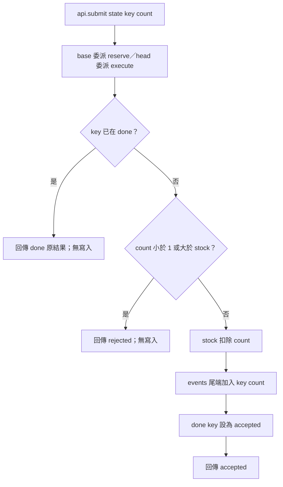

# 程式碼審查：S5 submit API 移轉

## 1. 基本說明

- **執行完成；Approve（建議通過）。** 約定有限輸入域的行為一致性 PASS；一般品質未發現阻擋。
- 尚存事項：已確認缺陷 F＝0、非阻擋建議 Q＝0、必要證據缺口 U＝0。無待解除項目。
- 現在先做：可依本次範圍採納移轉；若日後擴充輸入域或並行模型，另行驗收。
- 專案：[S5](/private/tmp/ai-review-real-20261009/S5)；舊 repo：[repo-base](/private/tmp/ai-review-real-20261009/S5/repo-base)；新 repo：[repo-head](/private/tmp/ai-review-real-20261009/S5/repo-head)。
- 實際開始：**2026-10-09 11:30:51 UTC（UTC+00:00）**；[原始時鐘輸出](/private/tmp/ai-review-real-20261009/S5/output/start.txt)。
- 目的：將公開 `api.submit` 的實作由 `legacy.reserve` 移至 `service.execute`，保留回傳及全部約定記憶體狀態。
- 限制：這是本機固定版本審查建議，沒有真實 PR／平台 review 動作；Mermaid 未實際渲染，不能聲稱視覺驗證。

## 2. 範圍說明

| 版本 | 原 ref／branch | 固定 commit |
|---|---|---|
| base | HEAD／master | `0470b8ec7cf06787cc072c1e7829b45127677fcc` |
| head | HEAD／master | `14b80ec98ef6be7a380060b2fa27632652773163` |

兩個獨立 repo 採完整固定快照比較，沒有推測共同祖先或以 merge-base 偷換版本。兩側 working tree 初查均乾淨。Git no-index patch 偵測 1 個修改及 1 個相似度 89% 的更名：`api.py`，`legacy.py → service.py`，共兩個 diff 區塊。更名是內容對照線索，不是共同歷史的主張。全部業務來源為兩側各 2 個 Python 檔案，已完整讀取；無生成檔、二進位或配置差異。

[完整檔案清單](#附錄完整檔案清單)列所有目標及關聯來源；[原始 patch](/private/tmp/ai-review-real-20261009/S5/output/command-08.json)保留 exit 1（代表存在差異，不是工具執行故障）。skill helper 固定的 [snapshots](/private/tmp/ai-review-real-20261009/S5/output/run/snapshots) 已 verify；提供的 base/head 目錄內容亦逐檔與指定 commit 的 git show 核對一致。

驗收邊界依 [contract](/private/tmp/ai-review-real-20261009/S5/contract.json)：每次初始 stock=3、events=[]、done={}；操作長度 1 或 2、key 為 a/b、count 為 0/1/2/3/4。共有 10+100＝110 個序列。比較每步回傳、錯誤、stock、done、events，保留事件順序及重複數。記憶體 dict 即完整狀態，沒有 DB／broker 必要補證。非整數、其他初始狀態、三步以上、同時呼叫或正式部署不在約定內；不是必要缺口。

## 3. 關聯與流程

### 全目標分析與雙向規則映射

先由舊方法獨立抽取 R1–R5，再檢查新方法與入口。以下來源行號均指上述固定 commit 的快照。

| 舊規則／來源摘錄 | 新責任對照 | 入口、狀態與影響 | 證據／結果 |
|---|---|---|---|
| R1：base/api.py:1–3，`return reserve(state, key, count)` | head/api.py:1–3，`return execute(state, key, count)` | 同名 submit 的參數與回傳保持；只替換 import 與委派目標 | source-reviewed、tested／PASS |
| R2：legacy.py:2–3，`if key in state['done']:`，`return state['done'][key]` | service.py:2–3 原樣保留 | replay 比 count guard 優先；count 改變仍回傳先前 accepted，不再扣庫存或發布事件 | source-reviewed、tested／PASS |
| R3：legacy.py:4–5，`if count < 1 or count > state['stock']:`，`return 'rejected'` | service.py:4–5 原樣保留 | 非既有 key 的 0 或超出當下庫存請求拒絕；guard 前沒有寫入 | source-reviewed、tested／PASS |
| R4：legacy.py:6–7，`state['stock'] -= count`，`state['events'].append({'key': key, 'count': count})` | service.py:6–7 原樣保留 | 有效新請求先扣庫存，再恰好加入一筆事件；不同 key 保留發生順序 | source-reviewed、tested／PASS |
| R5：legacy.py:8–9，`state['done'][key] = 'accepted'`，`return 'accepted'` | service.py:8–9 原樣保留 | 成功才建立 done；拒絕不快取，可在下一次有效請求成功 | source-reviewed、tested／PASS |

舊→新五條責任皆有落點；新→舊逐行檢查 service 全 9 行及 api 全 3 行，沒有額外 guard、預設值、事件或狀態寫入。新舊名稱不同不影響規則映射。移除舊模組的相容性已追 caller：唯一公開入口 api.submit 已切換 import；契約只保留 submit，不要求外部繼續 import legacy.reserve。未把契約外舊函式名刪除誤報為阻擋。

分析中的具體風險是「更名後 caller 是否仍可匯入」「冪等優先序是否移動」「拒絕是否偷偷寫入」「事件順序／重複是否被正規化」。查核動作分別是實跑真實 submit、逐行 guard 對照、逐步狀態觀測與保序比較器校準，皆已完成。

因本次主要判斷依賴 guard 優先序與副作用順序，使用一張共用流程圖；兩側拓樸一致，避免重畫相同流程。圖是**來源推導**，實測只擷取每步完成後狀態，沒有假稱追蹤每一內部行。



來源：[old api](/private/tmp/ai-review-real-20261009/S5/output/run/snapshots/old/api.py:1)、[old reserve](/private/tmp/ai-review-real-20261009/S5/output/run/snapshots/old/legacy.py:1)、[new api](/private/tmp/ai-review-real-20261009/S5/output/run/snapshots/new/api.py:1)、[new execute](/private/tmp/ai-review-real-20261009/S5/output/run/snapshots/new/service.py:1)。圖沒有畫成舊系統呼叫新系統；dict/list 異常與硬體記憶體耗盡非此契約接受域，不額外假造復原分支。Mermaid 原碼已核對方向與分支，未渲染。

## 4. 審查結果與問題

約定範圍**未發現阻擋或必要未知**；不硬造修改碼或改善清單。以下表格直接列尚存事項：

| 類別／狀態 | 數量 | 是否阻擋 | 推薦方案／解除條件 |
|---|---:|---|---|
| F 已確認缺陷 | 0 | 無 | 不需改碼 |
| Q 非阻擋建議 | 0 | 無 | 無 |
| U 必要證據缺口 | 0 | 無 | 無 |

### 實測、反證與比較器校準

兩側都由實際 `api.submit` 執行，獨立 Python 子程序匯入固定來源；runner 只建立輸入並保存深複製觀測，不複寫業務規則。所有 110 個序列、210 個步驟均一致，包含例如：

| 初始狀態皆為契約初值；操作 | 兩側實際結果 | 對應規則 |
|---|---|---|
| a:3 | accepted；stock 0、done a=accepted、events 一筆 a:3 | R3–R5 庫存等值邊界 |
| a:1 → a:0 | accepted → accepted；stock 2、events 只有 a:1 | R2 replay 優先於無效 count |
| a:0 → a:2 | rejected → accepted；stock 1、events 只有 a:2 | R3 拒絕不寫 done |
| a:2 → b:2 | accepted → rejected；stock 1、done 僅 a、events 僅 a:2 | R3 當下庫存 guard |
| a:1 → b:1 | accepted → accepted；stock 1、events 依序 a:1、b:1 | R4 事件順序／數量 |

[exhaustive log](/private/tmp/ai-review-real-20261009/S5/output/exhaustive.json) exit 0；[helper compare log](/private/tmp/ai-review-real-20261009/S5/output/compare.json) exit 0、110 cases PASS、零 differences／unknowns。此結論也依據完整來源與雙向映射，不直接把 helper PASS 當成業務驗收。

old→old 使用兩次獨立實跑並比對一致。另對同一份舊觀測複本，分別故意改回傳、庫存、done、重複一筆事件及倒置兩事件，原生比較與 skill compare 均抓到差異；helper 五次各 exit 1，未改動來源。[校準紀錄](/private/tmp/ai-review-real-20261009/S5/output/calibration.json)。為測 helper 比較功能，校準檔把舊觀測放入 new 欄位外殼；這些明確是**人工比較器測試**，不能拿來冒充新版執行證據；正式 new.json 來自真實新版 runner。

既有 [probe.py](/private/tmp/ai-review-real-20261009/S5/probe.py) 包含 7 個代表案例，已在兩側執行並保留 [old](/private/tmp/ai-review-real-20261009/S5/output/probe-old.json)／[new](/private/tmp/ai-review-real-20261009/S5/output/probe-new.json) 原始輸出。probe 只有列印，沒有斷言，也未窮舉 b 及所有序列；本次 110 案例比較補足驗收證據，不將 probe 的 exit 0 單獨當成功。

### 深度查核完成狀態

| 面向 | 實際方法與證據 | 結果／邊界 |
|---|---|---|
| 正確性 | 入口到完整 guard、扣庫存、事件、done、回傳逐行對照；110 組窮舉 | 已查；R1–R5 PASS |
| 安全／輸入 | count 接受域及 key 查詢優先序；無外部 IO、授權或動態 eval | 已查，未增加信任邊界；契約外型別驗證非本次必要項 |
| 可靠性／副作用 | 每步 error、三個狀態及重試／拒絕觀測；輸出深複製避免後步覆蓋前步 | 已查；純 dict/list 為真實完整狀態，未以 mock 冒充提交 |
| 並行 | 來源無 async／執行緒；契約明列 sequential 1–2 操作 | 不適用並行驗收，未宣稱 thread-safe |
| 效能／資源 | 新舊同樣字典查詢、一次 append，無新增迴圈或 I/O | 已查；沒有具體退化，未做無關 benchmark |
| 設計／相容 | api caller 及全部 import；參數、委派、回傳保持 | 已查；內部更名已接妥，不要求保留契約外 import |
| 測試有效性 | probe 限制分析；全域窮舉；old-old 與五類 mutation | 已查，觀測不排序、不去重事件 |

所有目標與差異區塊已對帳，無未讀或待查來源。未發現需排除的有效缺陷候選；沒有拿一般硬化偏好當 finding。

## 5. 結論

對上述固定版本、指定初始狀態及完整 110 個序列接受域，建議 **Approve**：審查執行完成、業務一致性 PASS、一般品質無阻擋，無核准例外及未解除 ID。這是範圍結論，不保證契約外輸入、並行或未來版本。來源、契約、runner 或觀測面改變時應重跑受影響案例並重新核對 caller；沒有提交平台審查或更動合併設定。

## 附錄：證據與查核依據

採用指定 [SKILL.md](/private/tmp/ai-review-real-20261009/skill/SKILL.md) 及 evidence、migration、deep-review、report references；專案規則為 [project-setting.md](/private/tmp/ai-review-real-20261009/S5/project-setting.md)。完整內容雜湊集中於 [hash-index.md](/private/tmp/ai-review-real-20261009/S5/output/hash-index.md)，不在正文重複。精確模型版本未知。Python／平台版本見 calibration.json；Git 命令及來源固定結果見 command-00 至 command-08。

流程產物涵蓋：原始開始時鐘、規則與契約／targets、完整 patch 與來源清單、舊規則 R1–R5、新舊雙向分析、helper prepare、全序列 runner 與 old-old、helper compare、五類人工校準、既有 probe、helper verify、報告回讀及 hash checker。來源未修改，未呼叫外部服務、安裝、提交或委派。

原始執行紀錄為 output 下 JSON，含 argv、stdout、stderr、exit_code；runner 子程序另存 old-execution.json、old-again-execution.json、new-execution.json。stdout 雖在工具 UI 曾截斷，磁碟 log 與 comparison.json 完整保存。所有業務 Python 執行使用 `PYTHONDONTWRITEBYTECODE=1`。

重現核心觀測（會更新 output 中執行產物，不碰來源）：

```sh
PYTHONDONTWRITEBYTECODE=1 python3 /private/tmp/ai-review-real-20261009/S5/output/tmp/test_all.py
PYTHONDONTWRITEBYTECODE=1 python3 /private/tmp/ai-review-real-20261009/S5/output/run/runner.py old
PYTHONDONTWRITEBYTECODE=1 python3 /private/tmp/ai-review-real-20261009/S5/output/run/runner.py new
```

helper 比較與校準的原始完整 argv 均在 compare.json、calibration-*-log.json；helper 報告拒絕覆寫，重跑應用 output 下新的 `--out` 檔名，而不刪除本輪證據。prepare.json、verify.json exit 0；hash checker 結果見 hash-check.json。

交付前實際回讀五章順序、首頁與事項表、規則／案例對照、最末清單、圖的 guard 與箭頭；結論一致且沒有遺留必要項。hash checker 只驗證檔案 hash，不代替審查判斷。

未做：Mermaid 實際渲染與契約外並行／型別／部署驗收。已知限制：結論僅涵蓋固定版本及上述有限輸入域。

## 附錄：完整檔案清單

| 狀態／舊→新路徑 | 符號／責任 | 差異作用／影響 | 分析狀態／證據 |
|---|---|---|---|
| M：base/api.py → head/api.py（各 1–3 行） | submit(state,key,count) 公開入口 | import legacy.reserve 改成 service.execute；委派目標同步變更 | 完整讀取；唯一 diff 區塊已查；R1、110 案例 PASS |
| R89 內容配對：base/legacy.py → head/service.py（各 1–9 行） | reserve → execute | 第 1 行函式更名；第 2–9 行行為不變；舊檔移除／新檔新增 | 完整讀取；唯一 diff 區塊及完整方法已查；R2–R5 PASS |

關聯但非業務 diff 的來源與材料：

| 路徑 | 責任／狀態 |
|---|---|
| repo-base/api.py、repo-base/legacy.py | 基準 committed 來源；完整來源已與 base 目錄及 helper snapshot 核對 |
| repo-head/api.py、repo-head/service.py | 候選 committed 來源；完整來源已與 head 目錄及 helper snapshot 核對 |
| contract.json | 完整需求／接受域來源，已讀 |
| targets.json | 固定 repo、ref、commit，已核對 |
| project-setting.md | 文件／測試產物只放 output 規範，已遵循 |
| probe.py | 既有 7 案例原始 probe，完整讀取並兩側執行 |
| output/run/runner.py、output/tmp/test_all.py | 本輪新增可重現 110 案例、狀態觀測與斷言；非被審來源 |
| output/tmp/calibrate.py、output/tmp/run_logged.py | 本輪校準與命令紀錄；非被審來源 |
| 各 repo .git metadata | 僅用 Git 解析 ref、tracked 清單、status、固定內容；非業務分析檔案 |

沒有未分析目標、被跳過的生成／二進位檔或必要來源缺口；其他 S*、oracle、歷史報告與母專案未讀。
