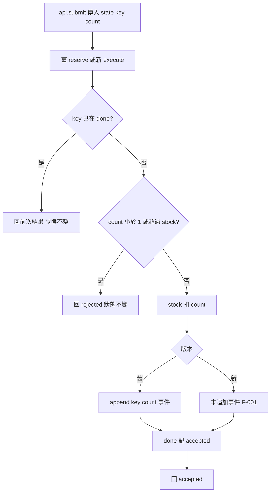

# S6：submit API 跨 repository 移轉審查

## 1. 基本說明

- **完成；Request changes（要求修改）**。行為一致性 FAIL，一般品質存在同一項成功路徑副作用遺失。
- 尚存：1 項已確認阻擋 [F-001](#f-001成功保留庫存卻遺失事件)，0 項必要證據缺口；第一步是在 execute 扣庫存後補回一次事件追加。
- 專案：[S6](/private/tmp/ai-review-real-20261009/S6)。舊 repo：[/private/tmp/ai-review-real-20261009/S6/repo-base](/private/tmp/ai-review-real-20261009/S6/repo-base)；新 repo：[/private/tmp/ai-review-real-20261009/S6/repo-head](/private/tmp/ai-review-real-20261009/S6/repo-head)。
- 實際開始：**2026-10-09 11:31:01 UTC（+00:00；臺北 19:31:01 +08:00）**，首次來源讀取前由時鐘工具取得，[原始紀錄](start-time.json)。
- 目的：legacy.reserve 移至 service.execute，保留 submit 回值、stock、done 與有序 events（含重複數）。無核准例外。
- 契約內 110 組序列均已執行，90 組有事件差異。圖未實際渲染；修法未套用或驗證。這是本地演練版本建議，未提交平台 review。

## 2. 範圍說明

| 側 | 原始 ref | 已固定 commit |
|---|---|---|
| 舊 | HEAD | 0470b8ec7cf06787cc072c1e7829b45127677fcc |
| 新 | HEAD | 3112b0916792d386e6a0c9a677619120f4c659ce |

兩個獨立 repository 採**直接快照對照**，不建立 merge-base 或虛構 PR diff。HEAD 與 targets.json 一致，兩側工作樹乾淨。helper prepare 固定 committed snapshots；base/head 提供目錄、repo 內容與 helper 快照逐檔 bytes 相同，見 [綁定紀錄](logs/source-binding.json)。

完整 diff 為 1 修改、1 刪除、1 新增，共 3 個路徑項目、3 個差異區塊；兩側各 2 個 Python 檔，沒有二進位、生成檔、套件配置或 repository 內測試。完整 patch 已保存，exit 1 為正常「有差異」，不是執行故障。清單先於關聯分析建立，見 [階段紀錄](target-analysis.md)；最終對帳見[完整檔案清單](#附錄完整檔案清單)。

完整驗收域來自 [contract.json](/private/tmp/ai-review-real-20261009/S6/contract.json)：每案例新建 stock=3、events=[]、done={}；keys=a/b，count=0/1/2/3/4；操作序列長 1 或 2，共 10+100=110 組。對每一步觀測回值、例外與完整 state。記憶體 dict 是完整狀態邊界，不欠缺 DB/broker 整合證據。排除其他型別、初始狀態、長序列及並行，不把範圍外材料當成 U 缺口。

## 3. 關聯與流程

舊側先獨立記錄 [R1–R6](old-rules.md)，再讀新側。api.submit 的 import 與委派目標一起改動；公開簽名及傳參保持。legacy.reserve 責任全部轉入 service.execute，唯成功事件 append 找不到替代。caller probe.py 只轉交參數並觀察 state，沒有 guard 或後置事件補寫。

因本次差異涉及條件優先序與成功路徑副作用，用一張流程圖定位遺失的步驟；圖是固定來源推導，**不是執行追蹤且未渲染**。舊、新各自執行自己的分支，兩系統不互相呼叫。



來源：[舊 API](run/snapshots/old/api.py)、[舊 reserve](run/snapshots/old/legacy.py)、[新 API](run/snapshots/new/api.py)、[新 execute](run/snapshots/new/service.py)，commit 如第二章；圖中的共同節點為兩版相同責任的簡化表示，並非共享物件或呼叫跨 repo。合法契約輸入不會引發 Python 例外；其他型別不在圖內。

| 舊規則→新映射／新→舊核對 | 來源 | 驗證與結果 |
|---|---|---|
| R1 submit 原樣委派 | old/api:1–3 → new/api:1–3 | source-reviewed、tested；PASS |
| R2 done 優先，變動 count 仍 replay | old/legacy:2–3 → new/service:2–3 | source-reviewed、tested；PASS（重放操作本身不修改狀態） |
| R3 count<1 或超庫存拒絕、不變更 state | old/legacy:4–5 → new/service:4–5 | source-reviewed、tested；PASS |
| R4 成功精確扣 count | old/legacy:6 → new/service:6 | source-reviewed、tested；PASS |
| R5 每個首次成功依序追加一筆事件 | old/legacy:7 → 新側缺少 | source-reviewed、tested；FAIL，F-001 |
| R6 done 記 accepted 並回 accepted | old/legacy:8–9 → new/service:7–8 | source-reviewed、tested；PASS |

反向盤點 new/service 全 8 行與 new/api 全 3 行均落在上述映射，無其他新增 guard、預設值、狀態寫入或例外；規則結果表示該責任，不以其他欄位一致掩蓋事件失敗。事件順序與 multiplicity 使用 list 原樣比較，不排序或去重。

## 4. 審查結果與問題

F 表示已確認缺陷；無 Q 調查項、無 U 必要缺口。

| ID／狀態 | 影響 | 阻擋理由 | 推薦方案 | 解除條件 |
|---|---|---|---|---|
| [F-001](#f-001成功保留庫存卻遺失事件)／open | 成功扣庫存但 events 永遠缺失新事件 | 違反明確要求的 R5，無例外 | 在扣庫存與 done 寫入間追加事件 | 修正固定版本後完整 110 組逐步觀測一致，重放不得重複事件 |

### F-001：成功保留庫存卻遺失事件

位置：新 commit 3112b0916792d386e6a0c9a677619120f4c659ce，[service.py 第 6–8 行](/private/tmp/ai-review-real-20261009/S6/output/run/snapshots/new/service.py:6)，函式 execute(state, key, count)；受影響入口為 api.submit 第 3 行。這是本次移轉新增的高影響業務回歸，阻擋依據為契約 R5，而非嚴重度標籤。

**新版本完整原始程式（1–8 行；無插入註解）：**

```python
def execute(state, key, count):
    if key in state['done']:
        return state['done'][key]
    if count < 1 or count > state['stock']:
        return 'rejected'
    state['stock'] -= count
    state['done'][key] = 'accepted'
    return 'accepted'
```

**建議修改（在第 6 行之後插入；未套用、未驗證）：**

```python
    state['stock'] -= count
    state['events'].append({'key': key, 'count': count})
    state['done'][key] = 'accepted'
```

這恢復 [舊 legacy.py 第 7 行](/private/tmp/ai-review-real-20261009/S6/output/run/snapshots/old/legacy.py:7) 的原有副作用，保留前面的 replay／拒絕 guard，故不在重放時追加事件。

**實際觀測：** 初始 state 為 `{'stock':3,'events':[],'done':{}}`，呼叫 `submit(state, 'a', 1)`：

| 欄位 | 舊／預期 | 新／實際 |
|---|---|---|
| return | accepted | accepted |
| stock | 2 | 2 |
| done | {'a': 'accepted'} | {'a': 'accepted'} |
| events | [{'key': 'a', 'count': 1}] | [] |

這不是回應映射造成的假差異；兩側經實際 submit 入口，各有獨立狀態、獨立程序，直接讀原 state。追加 `('b',1)` 時舊 events 有兩筆且依 a→b 順序，新仍為空；同 key 重放不會補回先前遺失事件。

反證查核：已讀完整新函式、API caller 與 probe；沒有上游排除 count=1、事件補寫或後置 processor，contract 明定 events 是驗收觀測且無例外。新版未改 stock、done 或回傳只能證明部分責任保留，不能解除 F-001。

證據：[110 組原始執行](logs/exhaustive.json)、[舊 stdout](logs/run-old.json)、[新 stdout](logs/run-new.json)、[90 組完整反例](counterexamples.json)、[helper compare](logs/compare.json)；執行 harness exit 0，helper 因有效差異 exit 1，無 unknowns。解除需修正新固定 commit，重跑完整域、old-old 與突變校準；確認接受操作各追加一次、拒絕及重放不追加，不接受刪除 events 觀測來取得通過。

### 其他面向查核

| 面向 | 實際檢查與結論 |
|---|---|
| 正確性、邊界 | 逐步比較所有 110 序列；0、4、耗盡、部分成功後不足、拒絕後同 key 重試及 changed-count replay 均包含；回值、stock、done、error 一致，events 差異合併 F-001。 |
| 安全、信任邊界 | 無 I/O、注入 sink、憑證、授權／租戶或相依變更；count guard 保留。規格以有限整數與 a/b 定義輸入，不憑空要求其他型別驗證。 |
| 可靠性、副作用 | 審查各狀態寫入及 replay 優先序；唯一缺失為事件。記憶體 dict 為真實驗收狀態，沒有模擬外部提交。 |
| 並行、取消 | 本契約為同步單次／雙次序列，無 async、執行緒、取消或 broker；未主張並行安全，無需另列必要缺口。 |
| 效能、資源 | 函式固定次數 dict/list 操作，沒有新增查詢、迴圈、資源持有；未發現本次新增效能風險，不做範圍外 benchmark。 |
| 設計、相容性 | 全 caller 與公開 submit 簽名已查；import 跟委派同步，內部名稱變更符合契約。無額外風格 finding。 |
| 測試 | repo 無測試；提供 probe 只有 print。已實跑兩側七案例，再用完整域 harness 補足。old-old 獨立執行相同；對實際舊觀測施加遺失、重複、順序交換與 count 錯誤皆被比較器抓出。人工突變是 comparator 校準，不冒稱產品執行。 |

所有 3 目標、3 diff 區塊及關聯 probe 已對帳，沒有工具失敗或未讀來源。未提供模型精確版本，記為未知。

## 5. 結論

**Request changes；審查執行完成；業務一致性 FAIL。** F-001 為唯一未解除阻擋，90/110 序列呈現實際事件遺失，不能採納此版本的移轉。一般品質結論也受同一副作用回歸阻擋，無額外獨立缺陷或必要未知。

先補回 execute 的事件追加，再固定修正 commit 重跑本輪完整驗收與校準；只有所有必要觀測一致後才能重判。未修改來源、skill 或外部平台，未查平台合併規則。圖未渲染、修法未實跑；此限制不影響已實跑的阻擋反例。

## 附錄：證據與查核依據

- [hash 索引](hash-index.md) 納入實際 skill、四份 reference、規則、契約、版本、來源、harness、原始 logs 與報告；完整值僅保留索引。模型精確版本未知。Python/Git 版本見 [環境紀錄](logs/source-binding.json)。
- 所有主要執行的 argv、stdout、stderr、exit code 在 logs/*.json，記錄器為 [record.py](tmp/record.py)；讀取前時鐘紀錄獨立保存。採用的 skill 為 [/private/tmp/ai-review-real-20261009/skill/SKILL.md](/private/tmp/ai-review-real-20261009/skill/SKILL.md)，reference 為同目錄 references 的 evidence.md、migration.md、deep-review.md、report.md。
- [prepare](logs/prepare.json)、[verify](logs/verify.json) exit 0；[diff](logs/patch.json) exit 1 為有差異；[probe 舊](logs/probe-old.json)、[probe 新](logs/probe-new.json)、[harness](logs/exhaustive.json) exit 0；[compare](logs/compare.json) exit 1 為 FAIL。
- [校準](calibration.json)：獨立 old-old 110 組一致，對同一比較邏輯的四種受控錯誤全部偵測；沒有 ID／業務值 adapter，JSON 只做表示序列化，list 順序、重複數及每步狀態保留。
- 重現：`PYTHONDONTWRITEBYTECODE=1 python3 /private/tmp/ai-review-real-20261009/S6/output/tmp/harness.py`。此命令重新執行原快照並更新 output 觀測；原版預期仍為 90 個反例。helper compare 完整命令見 logs/compare.json，重跑請用新的 --out 檔名避免覆寫保護。prepare/verify 的原始命令同樣保留在對應 log。
- 報告實際回讀與 hash checker 結果見 [交付檢查](logs/delivery-check.json)、[hash checker](logs/hash-check.json)。圖只做來源／guard／箭頭人工核對，未宣稱視覺驗證。

## 附錄：完整檔案清單

| 狀態／舊→新路徑 | 責任與差異區塊 | 影響／分析結果 |
|---|---|---|
| M api.py → api.py | import、submit；@@ -1,3 +1,3 | reserve 改 execute；原參數委派保留，全檔已讀、caller 已追、入口實跑，R1 PASS |
| D legacy.py → — | reserve；@@ -1,9 +0,0 | 舊六條規則獨立盤點；事件移除無替代，F-001；其餘映射完成 |
| A — → service.py | execute；@@ -0,0 +1,8 | replay、guard、stock、done、return 已映射；第 6–8 行缺事件，F-001 |

| 關聯且非 diff 來源 | 責任／查核結果 |
|---|---|
| probe.py | 七案例呼叫者、無 assert；全檔已讀並兩側實跑 |
| contract.json | 完整有限驗收域與副作用要求；全內容已讀 |
| targets.json | 獨立 repo、HEAD、完整 commits；已解析核對 |
| project-setting.md | 文件只寫 output/；全內容已讀並遵守 |
| base/、head/ 對應 Python 檔 | 原提供快照，全部 bytes 與 committed helper 快照／repo 相同；非額外變更 |

無生成檔、二進位或未讀目標。Git metadata 不作業務來源；其他 S 情境、父層 oracle、歷史報告與母專案未讀。僅 output/ 為本輪新增產物，來源與 skill 保持唯讀。
