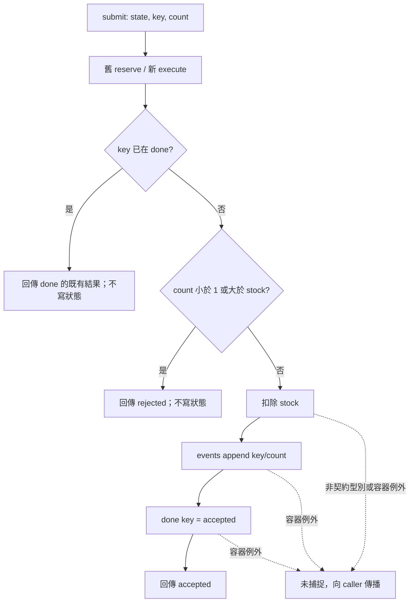

# S7 移轉程式碼審查

## 1. 基本說明

- **建議：Hold（暫緩）；執行狀態：部分完成。** 全部來源、caller、差異區塊與本地指定輸入域已審查；契約要求的完整執行證據審查尚缺真實 DB／broker 證據，不能改以模擬一致性驗收。
- 已確認阻擋缺陷 0、非阻擋建議 0；必要證據缺口 2：[U-001](#u-001真實-db-回滾缺證)、[U-002](#u-002跨重試事件-exactly-once-缺證)。整體需求符合性及移轉一致性 **UNKNOWN**；本地有限模型一致性 PASS。
- **第一步：補齊對應固定版本的 DB driver、schema、broker adapter、部署／交易設定，以及隔離環境的失敗與重試原始執行證據。** 本輪禁止連線外部服務，未嘗試取得憑證或執行正式環境操作。
- 專案：[S7](/private/tmp/ai-review-real-20261009/S7)。舊 repository：[repo-base](/private/tmp/ai-review-real-20261009/S7/repo-base)；新 repository：[repo-head](/private/tmp/ai-review-real-20261009/S7/repo-head)。
- 開始時間：**2026-10-09 11:31:17 UTC（UTC+00:00；臺北 19:31:17 UTC+08:00）**，讀業務來源前由 clock 工具取得；[原始紀錄](start.json)。
- 目的：將 submit 的實作從 legacy.reserve 移轉到 service.execute，保留回傳、stock、done、事件順序與重複數，並核對契約要求的持久化失敗及重試語意。
- 這是本機範圍審查建議，未提交平台 review，未變更合併政策。模型精確版本未知。

## 2. 範圍說明

| 項目 | 舊側 | 新側 |
|---|---|---|
| 提供的 ref／實際 branch | HEAD／master | HEAD／master |
| 固定 commit | a9fabff50c6d3b2be51e1cc18da2527709eaecb3 | aedb2ff70e63fef785d9210eddf30595e8e72386 |
| 檔案 | api.py、legacy.py | api.py、service.py |
| 工作樹狀態 | clean，無 untracked | clean，無 untracked |

兩個獨立 repository，以固定版本的直接快照作內容對照，不使用三點 diff、不猜共同祖先。先取得完整 Git tree、狀態與 no-index patch；[inspection.json](inspection.json) 中 diff exit 1 表示存在差異，不是工具故障。3 個差異目標：1 修改、1 刪除、1 新增，皆為 Python，無 binary／生成檔。舊 legacy.py → 新 service.py 是責任映射，不宣稱 Git rename。實體 base/head 內容已逐一核對技能 helper 所取固定 commit 快照。

完整原碼 4 個檔案皆已讀；關聯資料為 probe.py、contract.json、targets.json、project-setting.md。無額外 caller 藏於 Git tree；不推論資料包以外不存在其他 caller。完整對帳見[末節清單](#附錄完整檔案清單)。未讀其他情境、oracle、歷史報告或母專案。

驗收輸入為初始 stock=3、events=[]、done={}，key=a/b，count=0/1/2/3/4，長度 1 或 2 的操作序列。10+100=110 組，逐操作觀測回傳、例外與完整狀態；events 保留陣列順序及重複數。這個窮舉覆蓋指定的本地有限輸入域，並不涵蓋真實 DB／broker 失敗、跨程序競爭或持久化重試。

## 3. 關聯與流程

來源先讀舊 legacy.reserve，再讀 submit caller；由舊側建立規則，再讀新 execute 及 caller。需求與舊碼交叉核對後，得到以下雙向對照；R1–R5 的 source-reviewed 與 tested 均適用本地模型，R6–R7 為契約額外要求，不從模擬 append 推導真實保證。

| 規則 | 舊側來源與最小摘錄 | 新側對照與反向核對 | 證據／結果 |
|---|---|---|---|
| R1 公開入口直傳參數與回傳 | [api.py:1](/private/tmp/ai-review-real-20261009/S7/base/api.py:1) `return reserve(state, key, count)` | [api.py:1](/private/tmp/ai-review-real-20261009/S7/head/api.py:1) `return execute(state, key, count)`；只換 import 與呼叫符號 | source-reviewed、tested／PASS |
| R2 已存在 key 先重播，即使 count 已變 | [legacy.py:2](/private/tmp/ai-review-real-20261009/S7/base/legacy.py:2) `if key in state['done']:`、L3 `return state['done'][key]` | [service.py:2](/private/tmp/ai-review-real-20261009/S7/head/service.py:2) L2–3 同規則，無新增 guard | source-reviewed、tested／PASS |
| R3 count <1 或超庫存拒絕，不寫任何狀態 | legacy.py L4–5 `if count < 1 or count > state['stock']:`、`return 'rejected'` | service.py L4–5 相同；拒絕前只有 done 查詢 | source-reviewed、tested／PASS |
| R4 成功扣庫存、追加事件、寫 done，維持此順序 | legacy.py L6–8 `state['stock'] -= count`、`state['events'].append({'key': key, 'count': count})`、`state['done'][key] = 'accepted'` | service.py L6–8 相同，反向無額外寫入或刪除 | source-reviewed、tested／PASS |
| R5 成功回傳 accepted；重試不重扣、不重發 | legacy.py L9 `return 'accepted'` 與 R2 | service.py L9 與 R2；所有成功出口均對應舊側 | source-reviewed、tested／PASS |
| R6 broker 發布失敗時真實 DB transaction rollback | contract.json；舊碼僅記憶體容器 | 新碼仍是模擬，沒有 driver、schema、adapter、交易設定 | U-001／UNKNOWN |
| R7 retry 後 exactly-once observable event | contract.json；本地 R2 僅能保證共享字典中的順序重播 | 新側相同，但未觀測外部 broker、consumer、跨程序重試 | U-002／UNKNOWN |

影響分析：api.py 的目的為替換業務實作入口，輸入和回傳介面不變；刪除 legacy.py 的全部責任移至新增 service.py，資料結構與副作用沒有新增或移除；probe.py 經 PYTHONPATH 載入各側 api，消費回傳與最終狀態。未發現需要更新的資料格式或呼叫簽名。對外持久化語意則不能由此有限程式確認。

因判斷依賴「先查 done，再驗證 count，最後依序寫入」，用一張流程圖呈現兩側相同拓樸；入口註記兩個版本，沒有畫成舊系統呼叫新系統。此圖是**來源推導**，不是 runtime tracing；來源固定於上表兩個 commit 的 api.py L1–3 與 legacy.py／service.py L1–9。



圖中例外出口只說明原碼未捕捉例外，不代表真實 broker 故障能由這個容器模擬；標準 dict/list 與約定型別的有限案例未發生例外。真實 DB／broker 路徑未知，未畫出猜測的 commit、rollback 或補償。**Mermaid 未實際渲染，只有原始碼與箭頭邏輯檢查，未宣稱視覺驗證。**

## 4. 審查結果與問題

F 代表已確認缺陷，U 代表必要證據缺口。本輪無可確認的來源回歸；兩項 U 仍阻止驗收，不把「無環境可執行」誤報為程式缺陷。

| ID／狀態 | 問題與影響 | 是否阻擋／理由 | 推薦方案 | 解除條件 |
|---|---|---|---|---|
| [U-001](#u-001真實-db-回滾缺證)／open | 發布失敗時真實持久化結果未知 | 阻止放行，契約必要證據缺漏；非已證實 bug | 補同版本交易設定與隔離 DB/broker 故障實測 | 故障後獨立連線讀取證明 DB 完整回滾 |
| [U-002](#u-002跨重試事件-exactly-once-缺證)／open | broker 已接受但呼叫端重試時，外部事件重複數未知 | 阻止放行，契約明定 exactly-once | 補 ack 遺失／重試案例及 consumer 觀測 | 相同 key 重試後可觀測事件恰一筆，資料與結果一致 |

### U-001：真實 DB 回滾缺證

相關位置：[新版 service.py:6](/private/tmp/ai-review-real-20261009/S7/head/service.py:6) L6–9。這是正確的**模擬原碼**，不是已確認問題碼：

```python
    state['stock'] -= count
    state['events'].append({'key': key, 'count': count})
    state['done'][key] = 'accepted'
    return 'accepted'
```

缺的是 DB driver、schema、broker adapter、部署／交易設定和實跑紀錄，無法判斷 R6。舉例：真實庫存 3、空 done／事件，提交 a/1，在 broker publication 失敗點注入故障；預期 DB 最終 stock=3、done 無 a，沒有部分提交；實際 **未觀測**。目前只看到 Python list append 成功，不能證明 transaction rollback，也不能由沒有 rollback 程式就斷言正式版本必然缺陷。

反證查核：已讀雙側完整方法、兩個 api caller、probe 及契約；契約明示程式只是 persistence simulation。沒有可取得的交易代理或 adapter 可以支持或推翻正式失敗判斷。責任人待指派。

推薦先提供對應上述版本的實際整合來源與設定，再於隔離環境注入 broker 拒絕／timeout，留原始命令、錯誤、transaction log，以及操作前後由獨立 DB connection 讀取的 stock/done。未提供 API，無法可靠給可套用修碼，故不虛構 transaction wrapper。解除以失敗確實觸發且持久化狀態完整回滾的可追溯證據為準；模擬容器拋錯不合格。

### U-002：跨重試事件 exactly-once 缺證

相關位置：[新版 service.py:2](/private/tmp/ai-review-real-20261009/S7/head/service.py:2) L2–3：

```python
    if key in state['done']:
        return state['done'][key]
```

及 U-001 摘錄中的 L7–8。這些語句證明本地完成後的同 key 呼叫會重播；未證明「broker 已接受事件而應用尚未記錄 done」的失敗窗會如何處理。例子：stock=3，提交 a/1，broker 接受事件後 ack 遺失，再以 a/1 重試；預期 consumer 可觀測事件恰 1 筆且只有一次成功扣庫存。真實結果 **未觀測**，不能把 110 組順序字典測試當作該案例通過。

反證查核：api 沒有額外 retry/dedup guard；probe 只有一般順序重試，無外部觀測；契約未核准例外。不能因程式未含 broker 就主張一定會重複發布；這是 R7 證據缺口。責任人待指派。

推薦補實際 adapter／retry 配置，以及 ack 遺失、發布失敗後重試和相同 key 改 count 的原始 trace，關聯同一 logical key、交易與 broker/consumer 記錄，保留事件順序與重複數。需能分辨「發送呼叫次數」與「consumer 可觀測事件數」。未取得相關 API／持久化設計，無可靠修碼可提供。解除須證明失敗與重試確實發生、消費端恰一筆事件、DB 與回傳符合契約；必要時包含重啟後重試以排除只靠記憶體去重。

### 已查面向與反證結果

| 面向 | 方法／證據 | 結果與界限 |
|---|---|---|
| 正確性／邊界 | 完整 guard、caller、110 組序列與逐步狀態 | 本地 R1–R5 一致；0、3、4、耗盡、同 key 改 count、先拒絕後成功均涵蓋 |
| 安全／信任邊界 | 有效域依 contract；無 SQL、動態 eval、外部 I/O、credential、租戶資料 | 此 diff 未新增可確認的 injection／授權問題；域外型別、正式 API auth 不冒稱已驗證 |
| 可靠性／副作用 | 分析扣 stock→append→done 的順序及無 try/except | 模擬順序一致；真實失敗語意為 U-001／U-002 |
| 並行／冪等 | 順序重試與 done guard；無 thread/async 原碼 | 本地順序重播一致；真實共享狀態與 retry 互動缺證歸 U-002，不宣稱排程完整覆蓋 |
| 效能／資源 | 固定次數 dict/list 操作，無新增 loop／查詢 | 未引入可確認的熱路徑成本回歸；不做無依據 benchmark |
| 設計／相容性 | 兩個 caller、完整函式、全部 diff hunk | submit 簽名與格式未變，符號替換完整；無純風格阻擋 |
| 測試有效性 | probe 7 組於兩側實跑；自建 110 組逐步觀測；old-old 與 mutation 校準 | old-old 一致；人工複製事件可被 comparator 抓出；原始 probe 缺故障整合案例已列 U |

比較器以穩定 JSON 序列化比較完整巢狀值，僅排序 object keys，不排序 events、不去重、不捨棄欄位；輸入只含字串及整數，無浮點容差問題。adapter 只有選擇原始 api import 路徑與保存觀測，沒有重寫業務規則。mutation 只改 output 內的觀測副本，**不是原碼變更或真實 broker 失敗測試**。

## 5. 結論

固定版本範圍建議 **Hold**。來源與本地執行查核完成，但約定的完整證據審查**部分完成**；移轉整體及需求符合性 UNKNOWN，一般品質在已讀有限來源未發現可確認阻擋。110 組完全一致及比較器校準只支持本地 R1–R5，不解除 U-001／U-002。

先補實際整合來源／設定與同版本隔離執行證據，再依 U-001 驗真實 rollback、依 U-002 驗事件觀測與重試，最後重審。若版本或 runner 改動，重驗受影響本地案例並保留既有證據。沒有核准例外，不應現在 Approve；若新證據形成有效反例，再改判 Request changes。

## 附錄：證據與查核依據

- [技能、規則、來源、工具與產物 SHA-256 索引](hashes.md)；本輪用到 SKILL.md、deep-review.md、migration.md、report.md、evidence.md、review.py、check_report_hashes.py；未使用外部服務或安裝依賴。
- [來源盤點／完整 patch／原始 stdout、stderr、exit code](inspection.json)，規範與工具重讀之命令／原始輸出（初讀後補存，不冒充初讀時間）另存 [initial-reads.json](initial-reads.json)。
- [全部執行紀錄](execution.json)：固定 snapshot prepare／verify、Python/platform 版本、雙側 probe、old 兩次及 new 的 cases；各子程序 exit 0。prepare／verify log 證明 committed snapshot，並有 assertions 核對所提供 base/head 內容一致。
- [比較結果](comparison.json)：110 組、old-old 通過、人工 duplicate-event mutation 被偵測、舊新差異 0。[舊原始觀測](cases-old.stdout)、[重複舊觀測](cases-old-repeat.stdout)、[新觀測](cases-new.stdout)、[已知壞觀測](known-mutation.json)。
- [完整測試驅動程式](tmp/run.py)與[案例 runner](tmp/cases.py)。直接重現：`PYTHONDONTWRITEBYTECODE=1 python3 /private/tmp/ai-review-real-20261009/S7/output/tmp/cases.py /private/tmp/ai-review-real-20261009/S7/output/snapshot/snapshots/old`，new 改最後一路徑為 new；run.py 的 snapshot prepare 拒絕覆蓋既有 snapshot，這是證據保存保護，不應刪除原證據再假稱本輪結果。
- [hash checker 原始紀錄](hash-check.json)，核對通過與否以最後 exit code 為準。索引不納入自己或其 checker 輸出以避免循環雜湊。
- 交付前實際回讀五章正文與全部待辦，確認首頁／結論一致、無將 mock 等同真實提交、無把缺證升格為 bug；逐項核對來源行號、guard、圖箭頭與清單。未實際渲染 Mermaid。

## 附錄：完整檔案清單

| 狀態／舊→新路徑 | 方法／責任 | 差異作用／影響 | 分析狀態／證據／缺口 |
|---|---|---|---|
| M base/api.py → head/api.py | submit(state,key,count)，L1–3 | import reserve→execute；call target 替換；params/result 保留 | 全檔／全 hunk 已審，公開入口 tested，R1 |
| D base/legacy.py → 無 | reserve(state,key,count)，L1–9 | 原 guard、庫存、事件、done 與回傳責任移出舊模組 | 全檔刪除 hunk 已審，R2–R5 舊側 tested |
| A 無 → head/service.py | execute(state,key,count)，L1–9 | 承接 reserve 全部責任，只改名稱 | 全檔新增 hunk 已審，R2–R5 tested；真實整合 U-001/U-002 |

關聯且未列作 diff 的來源：

| 路徑 | 用途 | 查核狀態 |
|---|---|---|
| probe.py | 7 組原始例子；import api.submit；輸出 results/state | 全讀、雙側實跑；不足以證明真實故障 |
| contract.json | 必要規則、110 組有限域、DB／broker 額外義務 | 全讀並逐項映射，無核准例外 |
| targets.json | 兩側固定 ref／commit | 全讀並 Git rev-parse 核對 |
| project-setting.md | 限定產物 output/、測試 output/tmp/ | 全讀，寫入皆符合 |
| repo-base/api.py、repo-base/legacy.py | 舊固定提交原件 | tree、clean status、helper snapshot 與 base 位元組一致 |
| repo-head/api.py、repo-head/service.py | 新固定提交原件 | tree、clean status、helper snapshot 與 head 位元組一致 |
| DB driver、schema、broker adapter、部署配置、憑證 | 契約明示未提供 | 不可讀／未執行，必要證據 U-001/U-002；未連 live service |

沒有未分析的差異目標、binary 或生成程式；output/ 為本輪新證據，不是被審來源。Git hooks／objects 僅列檔不執行，Git 內部 metadata 不列業務來源逐行審查。
