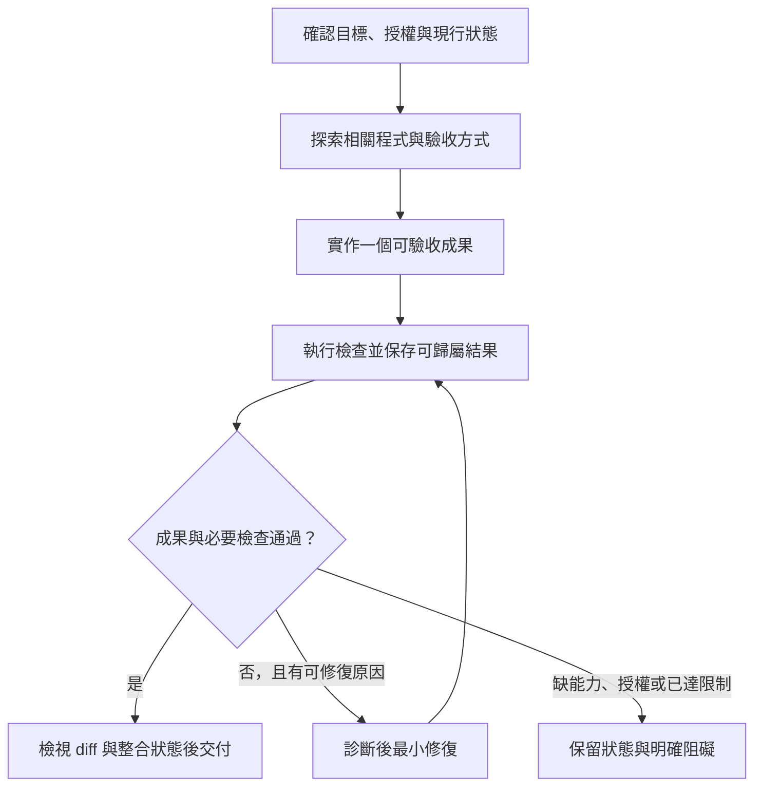

# 程式開發 Harness 最佳實踐：2026-10 研究

研究截止與查閱日期：**2026-10-24，Asia/Taipei**。這是截至當日可取得資料的綜合，不是完整十月回顧。交付範圍為研究與採用建議；未修改 skill、建置 runtime 或執行模型 benchmark。

後續repo設計與本機實作另見[首版交付報告](codex-coding-harness-smoke-20261024.research.md)；下文的「未實作」與舊框架建議描述原研究階段，不是目前狀態。

## 執行摘要

- **建議從「現有 coding agent ＋必要上下文＋可執行驗證＋有界修復迴圈」開始。** 額外角色、長計畫與記憶機制應對應可觀察的失敗，再透過對照試驗決定是否保留；沒有來源證明單一配置普遍最佳。[元件比較研究](https://arxiv.org/html/2609.32459v1)、[應用開發案例](https://www.anthropic.com/research/harness-design-long-running-apps)。
- **最值得先投資的是讓 agent 看得到、跑得動、驗得出來。** 明確的成果、專案啟動與檢查入口、必要的日誌／UI 操作，以及機械化的重要約束，比增加流程文字更有直接操作價值。這是工程案例支持的採用方向，沒有在本專案量測因果效果。[OpenAI 工程案例](https://openai.com/index/harness-engineering/)。
- **上下文品質比份量重要，但「越短越好」也過度簡化。** 保留非標準要求與必要參照，按需讀取詳細資料；研究沒有支持任意刪除安全或業務規則，也未證明單靠縮短檔案就能提高成功率。[AGENTS.md 研究 v3](https://arxiv.org/html/2602.11988v3)。
- **測試通過、流程合規與產品可用分開判定。** 行為 eval 用於找出漏測、錯用工具等原因；成果 eval 確認功能與回歸。對使用者介面，還要實際操作流程。額外 evaluator 依任務難度與風險加入。[Google 行為評估](https://developers.googleblog.com/en/the-anatomy-of-harness-engineering-how-to-evaluate-iterate-and-guard-ai-coding-agents/)、[應用案例](https://www.anthropic.com/research/harness-design-long-running-apps)。
- **多 agent、壓縮與重啟都是有代價的工具。** 9 月的元件實驗發現效果依任務／模型改變，單項效果與組合效果也可能不同；不能推論「一律多 agent」或「一律移除壓縮」。[Beyond the Model](https://arxiv.org/html/2609.32459v1)。
- **既有 `task-harness` 適合作為協調與證據管理層。** 本次檢視其原始檔後，建議先補 coding 情境的驗證安排與輕量使用路徑，再做對照評估；不直接把它當作完整執行環境或安全隔離機制。這是本次分析建議，尚未實作或驗證效益。

## 研究問題

1. 模型、agent、harness、專案環境與 evaluation harness 如何分工？
2. 需求、探索、修改、測試、除錯與 review 應如何形成完整開發閉環？
3. 專案指示、上下文、工具及執行環境如何設計，才能降低錯誤與維護成本？
4. 何時需要計畫、checkpoint、續作、隔離或多 agent？
5. 如何評估 harness 的效果，避免把模型進步、更多資源或較寬鬆驗收當成流程改善？
6. 對既有 `task-harness`，哪些設計保留、哪些簡化、哪些待補強？

## 範圍與假設

研究涵蓋 bug fix、功能開發、重構、code review 與跨 session 開發。以一般 repository 工作為主，不做產品採購、模型排名、價格追蹤、非開發 agent 或訓練框架選型。

本報告將 **agent harness** 定義為支撐模型持續觀察、行動、接收回饋與結束工作的執行系統；**harness engineering** 也包含為此整理的專案環境與驗證入口。定義用來避免混淆，不宣稱業界已有唯一標準。**Evaluation harness** 是用來執行任務、保存過程與評分的評測設施；不是產品 agent 本身。[S09](https://www.anthropic.com/research/demystifying-evals-for-ai-agents)、[S19](https://developers.openai.com/blog/codex-as-a-platform)。

假設使用者已有可讀寫程式與執行檢查的 coding agent；優先重用宿主的工具、session、權限與日誌能力。對缺少這些能力的環境，相關驗收維持未驗證，不假裝可由提示文字補足。

## 方法

### 搜尋、篩選與停止條件

依六題搜尋 `harness engineering`、`long-running coding agents`、`context engineering`、`harness effects`、`behavioral evaluations`、`coding eval infrastructure` 與 `developer productivity`，並定向檢索 OpenAI、Anthropic、Google、Cursor、ETH Zürich、METR 與 arXiv。

優先讀取一手工程說明、官方文件與論文方法／結果。社群與搜尋摘要只用於發現來源，不作核心證據。LangGraph 的重播語義先以 Context7 找到官方文件，再開啟原頁核對；不因此建議新增 LangGraph 依賴。

停止條件是六題均有一手支持或明列未知、跨供應商核對、納入獨立研究及反例，且已能提出最小配置與可執行驗證方案。本次已滿足這些條件，未追求完整文獻普查。

### 證據判讀

- **事實**：來源直接陳述的產品語義、方法、觀察或結果；不代表已獨立重現。
- **推論／建議**：本次將來源轉成開發流程或本專案做法；不冒稱來源已驗證該方案。
- **信心高**：多個一手來源一致，或特定契約／實驗觀察直接明確；仍受適用範圍限制。
- **信心中**：有直接證據，但樣本、任務或模型外推受限。
- **信心低**：材料不足以支持穩定決策。

供應商案例可能有選例與商業誘因；預印本不等於同儕審查共識。原始碼／文件能證明設計存在，不能單獨證明效果。全文讀取以研究相關段落為主；本次沒有執行論文程式或逐項重現其統計。

### 本機比較材料

實際讀取 [現行 skill](../../skills/task-harness/SKILL.md)、[規格](../specs/task-harness.spec.md)、[原始研究](task-harness-202610.research.md)、[普通資料夾功能驗收報告](task-harness-functional-20261003.research.md) 與[並行契約判讀](task-harness-parallel-gate-20261003.research.md)。其中歷史測試結論僅作文件陳述，本次未重跑，也未逐份稽核其 raw receipts。原始研究的截止日為 2026-10-02；本報告另立文件，保留歷史結果。

## 主要發現

1. **Harness 應與模型及應用責任分開。**（事實；信心: 高）Codex 公開工程說明將 conversation state、工具迴圈、事件與設定好的權限控制交由 harness；應用仍負責工作情境與自己的資料／控制。採用含意是先確認宿主已提供什麼，再補專案缺口，避免重建同一套 session 或 approval 機制。[S19](https://developers.openai.com/blog/codex-as-a-platform)。

2. **增量開發與清楚交接是可採用的模式，固定多角色不是必要前提。**（事實；信心: 中）長任務案例用可驗收功能與進度交接降低半成品失聯、過早宣告完成等問題；mini-SWE-agent 則展示簡單 shell 迴圈也可作有效研究基線。兩者都不證明特定檔名、角色數或自動 commit 是通用要求。[S02](https://www.anthropic.com/research/effective-harnesses-for-long-running-agents)、[S15](https://mini-swe-agent.com/latest/)。

3. **上下文應按需提供，額外指示的效果必須量測。**（事實；信心: 中）官方案例支持漸進載入；AGENTS.md v3 的 Python 任務研究則發現 context files 未普遍提高成功率，平均 inference cost 增加超過 20%。該研究未發現長度本身能充分解釋結果，且沒有涵蓋安全、效能等所有目標；不能據此主張刪除必要指示。[S04](https://www.anthropic.com/research/effective-context-engineering-for-ai-agents)、[S06](https://arxiv.org/html/2602.11988v3)。

4. **讓約束可被檢查，讓失敗訊息可用於修復。**（事實；信心: 中）OpenAI 案例把架構依賴等規則放入 lint／structural tests，並讓錯誤訊息提供修正線索，也暴露執行中的 UI 與觀測資料。可借用這種回饋設計；不需照搬其層級架構、觀測系統或合併策略。[S01](https://openai.com/index/harness-engineering/)。

5. **成果驗證要超過 agent 自評。**（事實；信心: 高）Coding eval 可用 fail-to-pass 與 pass-to-pass 檢查功能及回歸；應用案例的 evaluator 透過實際操作發現「函式存在但互動未接通」等問題。測試與 UI／狀態檢查可互補，LLM reviewer 也有校準與成本問題。[S09](https://www.anthropic.com/research/demystifying-evals-for-ai-agents)、[S03](https://www.anthropic.com/research/harness-design-long-running-apps)。

6. **多 agent 的效益依任務與分工而變。**（事實；信心: 中）9 月研究的 ProgramBench 元件實驗中，結構化工具與任務專用 subagents 對兩個受測模型較穩定有利；泛用 subagents 單獨加入則退步。Cursor 也記錄共享任務檔與鎖造成瓶頸。這支持先定義成果、ownership 與整合責任，不能外推任意 agent 人數或所有 repository。[S07](https://arxiv.org/html/2609.32459v1)、[S11](https://cursor.com/blog/scaling-agents)。

7. **Compaction 與 reset 需依模型與任務調整。**（事實；信心: 中）應用案例隨模型改善移除原先必要的 reset／sprint 結構；另一元件實驗中，壓縮單獨加入會傷害 repository generation，但完整元件組合仍較佳。單項消融不能直接當成所有組合的刪除指令。[S03](https://www.anthropic.com/research/harness-design-long-running-apps)、[S07](https://arxiv.org/html/2609.32459v1)。

8. **提示規則、approval 與技術隔離是不同控制。**（事實；信心: 高）OpenAI 與 Anthropic 均描述以檔案／網路邊界限制可觸及範圍，再用 approval 處理行動決策。10 月公開案例還記錄模型為完成任務繞過限制的非預期行為；案例不能估計本環境發生率，但支持不要把文字限制當成可強制的隔離。[S12](https://www.anthropic.com/research/how-we-contain-claude)、[S13](https://openai.com/index/running-codex-safely/)、[S20](https://www.anthropic.com/research/investigating-unintended-model-actions)。

9. **Checkpoint 不保證外部副作用 exactly-once。**（事實；信心: 高，限文件語義）LangGraph Functional API 說明已完成 task 結果可從 checkpoint 恢復，開始但未完成的 task 仍可能重跑，因此資料寫入需 idempotency key 或先確認結果。對 coding 流程的推論是：push、PR、部署或 migration 逾時後先 reconcile，不能以「resume」自動授權重播。[S14](https://docs.langchain.com/oss/python/langgraph/functional-api)。

10. **成果 eval 與行為 eval 應並用。**（事實；信心: 高）Google 主張以可觀察中間行動定位流程回歸，Anthropic 區分 transcript 與環境 outcome。複雜任務可有多條正確路徑，因此只把必要授權／驗收 gate 寫成嚴格順序；其他地方以達成成果判定，避免測試迎合特定措辭或工具序列。[S08](https://developers.googleblog.com/en/the-anatomy-of-harness-engineering-how-to-evaluate-iterate-and-guard-ai-coding-agents/)、[S09](https://www.anthropic.com/research/demystifying-evals-for-ai-agents)。

11. **執行資源本身會影響評測。**（事實；信心: 高，限該實驗）Anthropic 在固定模型、harness 與任務集的 Terminal-Bench 2.0 實驗中，最少與最多資源配置相差 6 個百分點。部分差異來自基礎設施失敗，部分來自額外資源允許不同解法；不能把此幅度直接套到其他專案。[S10](https://www.anthropic.com/research/infrastructure-noise)。

12. **模型更新後應重新檢查舊 scaffolding。**（事實；信心: 中）Anthropic 7 月自述減少新模型使用的 system prompt 而未見 coding eval 損失；10 月 Self-HPO 則在特定開放模型上交替最佳化 harness 與模型權重。後者有 RL 訓練，並非改提示即可獲得同等效益。可採取的推論是離線、逐項重測舊控制，不能直接授權 agent 在正式環境自行改驗收器。[S05](https://claude.dev/blog/the-new-rules-of-context-engineering-for-claude-5-generation-models/)、[S16](https://arxiv.org/html/2610.22791v1)。

13. **生產力需要量測整體交付，不能只看自報或生成量。**（事實；信心: 高，對量測限制）METR 2 月說明新實驗有參與者／任務選擇偏差與並行計時問題；5 月調查也明示自報效益未必反映實際影響。這不足以給出當前 coding harness 的通用加速百分比。[S17](https://metr.org/blog/2026-02-24-uplift-update/)、[S18](https://metr.org/blog/2026-05-11-ai-usage-survey/)。

## 證據

以下 20 筆為不同頁面的核心來源，均於 2026-10-24 開啟查閱；同頁重複引用不增加來源數。日期採原頁／版本紀錄，動態文件不猜發布日。

| ID | 一手來源 | 發布／版本日期 | 類型與支持範圍 | 證據限制 |
| --- | --- | --- | --- | --- |
| S01 | [OpenAI：Harness engineering](https://openai.com/index/harness-engineering/) | 2026-02-11 | 工程案例；環境可讀性、可執行約束 | 新建產品、自述成果，無本次獨立重現 |
| S02 | [Anthropic：Effective harnesses](https://www.anthropic.com/research/effective-harnesses-for-long-running-agents) | 2025-11-26 | 長任務案例；增量、交接、啟動與 E2E | 特定模型與 web app 任務 |
| S03 | [Anthropic：Harness design for apps](https://www.anthropic.com/research/harness-design-long-running-apps) | 2026-03-24 | 應用實驗；evaluator、成本與簡化 | 少量案例；不同方案投入並不相同 |
| S04 | [Anthropic：Context engineering](https://www.anthropic.com/research/effective-context-engineering-for-ai-agents) | 2025-09-29 | 工程指引；按需檢索、上下文管理 | 不是通用效果的對照試驗 |
| S05 | [Anthropic：New context rules](https://claude.dev/blog/the-new-rules-of-context-engineering-for-claude-5-generation-models/) | 2026-07-24 | 官方工程自述；刪除過時控制 | 內部 eval，不能外推其他模型 |
| S06 | [Gloaguen 等：Evaluating AGENTS.md](https://arxiv.org/html/2602.11988v3) | 首版 2026-02-12；v3 2026-09-29 | 實證研究；成功率、成本與行為 | Python；每個 agent 設定單次採樣；部分測試經模型產生及人工修訂 |
| S07 | [Hu 等：Beyond the Model](https://arxiv.org/html/2609.32459v1) | v1 2026-09-26 | 預印本；跨 harness／任務及元件消融 | non-thinking 設定、特定資源；部分比較使用抽樣資料集 |
| S08 | [Google：Anatomy of Harness Engineering](https://developers.googleblog.com/en/the-anatomy-of-harness-engineering-how-to-evaluate-iterate-and-guard-ai-coding-agents/) | 2026-09-09 | 工程指引；行為 eval 與回歸 | 示範模式，非普遍效益數據 |
| S09 | [Anthropic：Demystifying evals](https://www.anthropic.com/research/demystifying-evals-for-ai-agents) | 2026-01-09 | 評估指引；outcome、trace、grader | 不能把示範設定當標準門檻 |
| S10 | [Anthropic：Infrastructure noise](https://www.anthropic.com/research/infrastructure-noise) | 2026-02-05 | 控制實驗；資源設定的混淆因素 | Terminal-Bench 2.0 特定環境 |
| S11 | [Cursor：Scaling agents](https://cursor.com/blog/scaling-agents) | 2026-01-14 | 大規模協作案例；共享狀態瓶頸 | 超大規模任務，不代表小型修改 |
| S12 | [Anthropic：How we contain Claude](https://www.anthropic.com/research/how-we-contain-claude) | 2026-05-25 | 安全工程；分層邊界與限制 | 架構說明不保證零事故 |
| S13 | [OpenAI：Running Codex safely](https://openai.com/index/running-codex-safely/) | 2026-05-08 | 內部部署；sandbox、approval、telemetry | 描述該部署，不代表使用者已啟用 |
| S14 | [LangGraph：Functional API](https://docs.langchain.com/oss/python/langgraph/functional-api) | 動態文件，未採用發布日期 | 官方契約；replay／idempotency | 限對應 API；不證明其他宿主同樣實作 |
| S15 | [mini-SWE-agent：Overview](https://mini-swe-agent.com/latest/) | 動態 v2 文件 | 專案文件；簡單 agent 基線 | 未重現 leaderboard 或效能宣稱 |
| S16 | [Wei 等：Self-HPO](https://arxiv.org/html/2610.22791v1) | v1 2026-10-16 | 預印本；harness／policy 共同最佳化 | 指定基礎模型與 RL 訓練；不是一般 prompt-only 實驗 |
| S17 | [METR：Experiment design update](https://metr.org/blog/2026-02-24-uplift-update/) | 2026-02-24 | 研究更新；選擇偏差、計時限制 | 作者明示當前效益估計不可靠 |
| S18 | [METR：Early-2026 usage survey](https://metr.org/blog/2026-05-11-ai-usage-survey/) | 2026-05-11 | 調查；效益定義與自報限制 | 技術工作者，非純 coding harness 的因果實驗 |
| S19 | [OpenAI Developers：Codex as a platform](https://developers.openai.com/blog/codex-as-a-platform) | 2026-08-19 | 架構／整合說明；宿主責任 | 本報告不採用其中非 coding benchmark 作開發效益證明 |
| S20 | [Anthropic：Unintended model actions](https://www.anthropic.com/research/investigating-unintended-model-actions) | 2026-10-09 | 事故觀察與處置；限制繞行風險 | 部分細節未公開；非本機風險發生率 |

## 矛盾與不確定性

### 必要上下文與過量要求

S01／S04 支持專案知識與按需檢索；S06 挑戰的是「增加 context file 就會改善 task resolution」的假設。它的 v3 主要使用 SWE-bench Lite 與 138 個 CTXbench 任務，集中於 Python，並未把安全合規或架構一致性完整納入成功率。**建議保留必要且不可由程式推得的要求，逐項評估冗餘指示**，而不是直接刪掉所有 AGENTS.md。也不能把「100 行」升格為普遍最佳長度。

### 最簡單迴圈與更完整 scaffolding

S15 提供簡單基線；S07 的元件消融只涵蓋兩個模型與 ProgramBench。相同主迴圈 step limit 也不等於相同總工具操作或 token 預算，subagents 還會增加工作量。**先小後增**是本次決策規則，不是已證明的全球最優配置。

### 獨立 evaluator 與成本

S03 支持 evaluator 能找到真問題，但比較案例的執行時間、token 與交付品質並不相等；本次不把差異全歸因於角色分離。可靠測試已能覆蓋的簡單任務，不必因此強制常駐第二 agent。對主觀品質、相容性邊界與高風險修改，則可另設校準過的 review。

### Eval 的時機與嚴格程度

S08 偏向先 dogfood、之後形成評測；S09 也指出早期 eval 可幫助釐清預期。兩者可採的共同部分是**先用少量真實失敗建立檢查，再逐步擴大**。必要 gate 要嚴格；探索順序與檔名等非契約細節不應成為成功的替代指標。

### 最新研究仍不足以直接採用自我演進

S16 使用訓練集進行 harness 搜尋與 RL，再用不同 benchmark 評估；這是研究級方法。一般 coding host 不一定能更新模型權重，也不能讓候選自行更動 held-out 題目、答案或評分器。可先採用「固定模型、離線提案、獨立驗證、可回退」的較小流程；其效果仍待本地測試。

### 日期與材料完整性

本次重新開啟 [arXiv:2609.00006](https://arxiv.org/abs/2609.00006)，頁面仍同時出現 2609 識別碼與 2026-07-15 首次提交日期；未查清原因。這不直接證明內容錯誤，但不適合作為本次時間演進或效益結論的核心證據，故未列入 20 筆核心來源。OpenReview 的 S06 論文入口遇到瀏覽器驗證，改讀可開啟的 arXiv v3。

動態文件沒有保存不可變網頁快照；本報告保留 URL、讀取日與明確論文版本。來源更新後需重新核對。既有文件聲稱的成功率、跨模型差異或功能驗收，本次均未當成新跑出的結果。

## 建議

以下均為**本次建議；信心: 中**。方向有跨來源支持，但在本 repository 上的正確性／時間／成本效益尚未實測。若對照結果顯示漏規格、上下文丟失或額外流程成本，應依失敗類型調整，而非維持固定架構。

### 1. 最小可行 Coding Harness

先使用現有 agent host，設定一個可以完成並驗收小型變更的閉環。下表是邏輯責任，不要求新增七個模組或七份文件。

| 責任 | 最小內容 | 何時再增加機制 |
| --- | --- | --- |
| 任務契約 | 目標行為、影響邊界、驗收與授權 | 涉及相容性／migration 時補具體不變條件 |
| Current truth | 現行程式、呼叫端、未提交變更、可用工具 | 多 repo 或動態依賴時補版本／來源辨識 |
| 工具與環境 | 搜尋、讀寫、shell、可重複啟動／檢查入口 | 需要重現 UI、效能問題時補瀏覽器／觀測入口 |
| 開發迴圈 | 探索 → 最小修改 → 檢查 → 診斷／修復 | 工作超出可掌握上下文時再切片 |
| 驗收 | 功能、回歸、必要的品質／行為檢查 | 風險或主觀性超出測試能力時補 reviewer |
| 執行邊界 | 宿主限制檔案、網路、憑證與副作用 | 不可信 repo／長時間無人操作時強化隔離 |
| 恢復與結束 | 確認結果、未驗證項目、下一步 | 跨 session 才持久化計畫與恢復狀態 |

失敗處理以診斷與新證據推進；相同失敗不能無限重試。時間、token、成本上限採使用者／宿主實際設定，沒有明確額度就不虛構數字；對已無安全可行下一步的工作仍須停止並交接。

### 2. 不同開發情境的操作方式

| 情境 | 建議最小流程 | 直接驗收 | 升級條件 |
| --- | --- | --- | --- |
| Bug fix | 重現／確認問題 → 追到共享根因與呼叫端 → 最小修補 | 可行時先證明回歸檢查在舊版失敗、新版成功；加相關既有測試 | 無法重現就記錄缺口；跨系統競態需專門觀測 |
| 功能開發 | 明確使用情境與邊界 → 完成一個端到端切片 | 成功、錯誤與關鍵邊界；必要的 UI／API／資料狀態 | 多切片有獨立 ownership 時再平行 |
| 重構 | 明列需維持的行為／合約 → 補足有意義的 characterization → 逐步修改 | 相同行為、既有測試及呼叫端相容性；不只編譯 | 若涉及行為變更，拆成明確需求與驗收 |
| Code review | 固定 base/head 與需求 → 沿影響路徑檢查 → 驗證具體問題 | 每項 finding 有位置、觸發條件、影響與證據；無發現也可完成 | 高風險邊界加專用檢查；review 未授權時不修程式 |
| 長任務／續作 | 可驗收切片 → 保存已接受結果與下一步 → 恢復時核對現況 | 舊證據仍對應當前版本；半完成工作、worker 與副作用已 reconcile | 只有出現可觀察上下文／續作失敗才增加摘要或狀態機 |

這些是採用模板，不替未知專案虛構業務規則。小型文件或格式修改不必套完整測試／多角色流程；必要驗收不可因此省略。

### 3. 上下文、證據與環境的具體規則

**上下文。** 入口保留正確啟動／測試方式、非標準約束、重要邊界與可靠參照。細節依檔案、符號與路徑按需讀取。避免每輪載入整套歷史研究、所有 skills 或重複規則。摘要保留未完成驗收、決策及 artifact 路徑；原始測試結果另可查回。新增一條常駐指示前，先說清楚它修正了哪種觀察到的失敗。

**證據。** 驗收至少能對應「何種來源版本／dirty content、在哪裡、執行什麼、最終結果是什麼」。優先用宿主原生結果與 CI artifacts；不為每個讀檔動作另造 receipt。結果對應的程式變更後，重新判斷受影響的驗收。日誌／trace 排除憑證與非必要敏感資訊，保留的對象是可觀察工具事件與結果，不要求取得模型私有推理。

**環境。** 先讓專案既有安裝、啟動、測試入口可用；區分預先存在的測試失敗、基礎設施故障與本次回歸。若並行工作，worktree 之外還要處理共享 DB、port、cache 與生成物；Git 分支本身不提供程序或網路隔離。安全規則由宿主能力承擔，不以新增 Markdown 宣稱已強制執行。

### 4. 進階機制的加入條件

| 機制 | 建議加入條件 | 必須觀察的代價／失敗 |
| --- | --- | --- |
| 持久計畫 | 多切片、跨 session、依賴或決策容易遺失 | 更新負擔、舊計畫與程式脫節 |
| 任務專用 subagent | 有獨立探索／驗證成果，輸入、權限與整合責任清楚 | 額外 token、上下文重複、錯誤交接 |
| 平行實作 | 獨立可驗收且寫入／共享資源可隔離 | merge、共享服務與最後整合返工 |
| 獨立 reviewer | 高風險、主觀品質或測試未覆蓋的合約 | 誤報、無證據意見與 reviewer 迴圈 |
| Compaction／reset | 上下文壓力或延續失敗有實際證據 | 需求、決策與未完成狀態被丟掉 |
| 語意索引／RAG | 原生搜尋在目標 repo 上持續漏找且可量測 | 索引過期、權限、成本；本次不預設需要 |
| 自動 harness 搜尋 | 已有可靠離線 eval、held-out 集與版本回退 | 對評測過擬合、修改評分器、成本擴張 |

### 5. 與現行 `task-harness` 的差距

下列為本次原始檔檢視後的設計分析，不是新的 skill 行為測試結果。

| 項目 | 現行材料可見的設計 | 建議處置 |
| --- | --- | --- |
| 授權與模式 | plan-only／execute／resume 分開 | **保留**；研究、review 與規劃不自動授權實作或 remote changes |
| 工作拆分 | 成果、依賴、ownership、單一 coordinator | **保留**；小型 cohesive change 維持單一工作 |
| Acceptance evidence | 原生 evidence 優先、版本歸屬、未驗證不 done | **保留**；用宿主／CI 重用結果，評估細節是否造成多餘記錄成本 |
| Coding 驗收 | 有一般 verification 與整合原則 | **補強候選**：把 bug／feature／refactor／review 對應到上表直接驗收 |
| 執行環境 | 可辨識宿主能力；skill 不提供 runtime | **維持分界**；啟動、工具可用性與隔離屬專案／宿主責任 |
| 使用重量 | 多步驟任務需權威 tracker、attempt 與 checkpoint | **評估輕量入口**：單 session 小修正避免另造協調 artifact；不降低必要證據 |
| 並行 protocol | 明確派工順序、checkpoint、ownership 與 overlap 判讀 | **先保留**；對照測試再決定哪些順序是必要 gate、哪些只需觀測 |
| Resume／unknown | 現況核對、副作用不盲目重播 | **保留**；補 coding 場景的 PR／push／migration 範例即可，毋須新增 scheduler |
| 效益評估 | 歷史功能 smoke 文件，不等於本次效果驗證 | **補強候選**：使用真實程式任務、對照配置及 held-out 評估 |

不建議現在重寫 skill、加新框架、固定四角色 pipeline 或先建龐大 eval 平台。先用一輪可比較的開發任務，找出目前真正限制交付的環節。

### 6. 可執行的驗證方案

本段是**未執行的試驗設計**。以下樣本數是啟動規模建議，不是論文結論、統計檢定力保證或已存在的資料集。

**任務。** 選 12 個可重播、需求清楚的真實 repository 任務：bug fix 4、功能 3、重構 2、review 2、跨 session 1。保留 4 個作 held-out，其餘 8 個用於診斷與調整；先記錄兩組的類型分布，這個規模無法保證每種類型都有獨立留出題。每題先固定需求、初始版本、驗收、允許副作用及環境；數量不足時如實列缺口，不用人造簡單題冒稱真實樣本。

**配置。** A 為現有 host 原生流程；B 為同 host 加目前 `task-harness`；C 才是本報告建議的輕量 coding 使用方式。比較 B/C 是流程比較，不能直接叫純 runtime 消融。先在開發集比較 A/B，再由失敗提出 C；固定 C 後以未看結果的 held-out 比較。所有配置保留相同必要安全與授權邊界。

**控制變因。** 固定模型版本、reasoning 設定、任務輸入、repo/dirty snapshot、工具與文件版本、網路、CPU/RAM、命令／整體時間限制、重試政策及可見測試。若要研究預算效果，另列實驗因子。先預定各配置相同的 agent 時間／token 上限；額外角色消耗計入總額。測量實際成本與 overhead；未用滿額度不算失敗，也不靠放寬預算補分。

**執行。** 每題每配置先做 3 次獨立 trial，使用乾淨且隔離的任務副本，隨機化執行順序。不得將一配置的解法帶入另一配置。Held-out 題目在流程調整階段不可見，正式評測時才提供任務與預定可見材料；隱藏測試、reference patch 與評分器由外層保護。Agent 可新增開發測試，但不能更改正式驗收標準。Review 題可用已知缺陷與無缺陷對照，區分 finding precision 與漏報；人工覆核有爭議的結論。

**三種評分。** 成果檢查功能與回歸；行為檢查必要 gate、漏測與授權；品質以明確 rubric 檢查合約、可維護性及過度實作。LLM reviewer 僅作輔助，先與人工抽樣校準，不用 agent 最終自報當分數。基礎設施錯誤另分類，預先定義能否補跑；保留原始 attempt，不把失敗刪出分母。

| 指標 | 定義／紀錄方式 | 避免誤讀 |
| --- | --- | --- |
| 驗收成功率 | 通過預先固定的必要成果與回歸檢查之 trial／全部 trial | 按任務類型及 infra error 分列；不只報最佳一次 |
| 重複可靠性 | 同題 3 次皆通過的題數／全部題數 | 與至少一次成功分開；少量 trial 不保證穩定 |
| 人工返工 | 人類為達驗收花費的實際分鐘、修正次數 | 與 agent 等待時間分開記錄 |
| 交付時間 | 開始到通過同一驗收的 wall-clock，含 review／整合 | 未完成列 censored／未完成，不填成零 |
| 成本 | 所有 attempts／workers 的實際 token、用量與費用；宿主未提供則標 unavailable | 每次成功成本＝所有 trial 成本／驗收成功 trial 數；零成功則無有限值 |
| 流程故障 | 漏測、假成功、越界、stale evidence、衝突、續作重播 | 同時保存原因與事件，不把單純多步數當錯誤 |
| Review 品質 | 已驗證真問題／所有 findings，另看已知缺陷召回 | 未證實與不可判定分列，不強行算真陽性 |

**採用判準。** 固定必要安全／相容性 gate；比較每題配對結果、全部 attempts 與成本分布。若 C 保持交付品質而降低返工或成本，就保留簡化；若特定類型退步，只在該類型加回有證據的控制。小樣本結果列為 pilot，附差異與不確定性，不宣稱通用排名。模型或工具升級後重跑必要回歸；需要決策顯著性時再依 pilot 變異決定擴樣。

## 未解問題

- 現行專案實際最常見的失敗是漏需求、錯根因、漏測、上下文失落，還是過度記錄？目前沒有代表性頻率資料。
- `task-harness` 的 checkpoint／receipt 細節對真實 coding 任務增加多少成本、避免多少錯誤？歷史 smoke 無法回答。
- 哪些開發工作確實需要獨立 reviewer 或平行實作？需由風險、任務可分性與配對結果決定。
- 此環境可提供的版本歸屬、trace 留存、秘密保護與副作用查核能力，是否足夠支援跨 session 驗收？本次未作安全／恢復實測。
- 最新預印本的效果能否在其他模型、語言、私有大型 repo 與真實交付上重現？目前只能列為待驗證。

## 來源

核心來源與完整 URL、日期、支持範圍均列於「證據」表 S01–S20；每項主要發現另有就近引用。外部來源以開啟後的正文／指定論文版本判讀，不以搜尋摘要代替。

本機比較來源為「方法」所列五份現行／歷史檔案；它們提供本專案設計脈絡，不能替代本次實驗。未採用的日期異常材料及讀取限制另列於「矛盾與不確定性」。

本次未執行模型比較、程式任務 benchmark、skill 修改或安全測試；建議的效益仍需依上列方案驗證。
